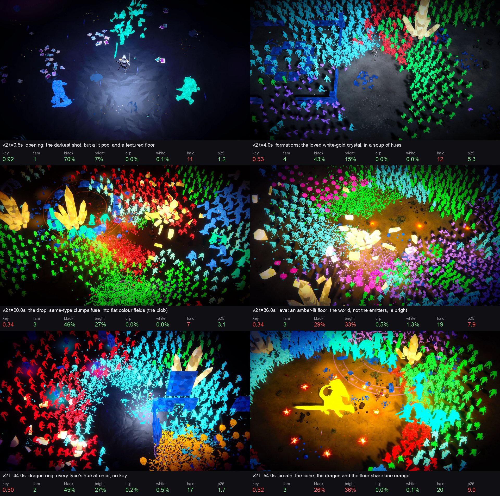

# The neon look's reference board (ps-wnj.1, 2026-11-01)

Six frames of the v2 crystal cut (`captures/trailer-crystal-v2.mp4`, the cut viewers reviewed)
measured against the frame-level rules of the [style guide](../../../../docs/design/neon-look-style.md#rules-and-thresholds).
Red numbers in `board.jpg` and ✗ below fail a rule. Mask rules (floor, monster form, swarm
separation, hero brightest) need the players' ID render and are measured by the look metrics
(ps-wnj.2); the frame's L* p25 stands in for the floor on a finished video.

```sh
uv run --project demo3d/tools python demo3d/evidence/look/style/board.py captures/trailer-crystal-v2.silent.mp4
```



| t (s) | frame | key60 (>= 0.55) | families (<= 4) | near-black (>= 30%) | bright (<= 32%) | clipped (<= 2%) | white (<= 2%) | halo dL* (>= 15) | L* p25 (<= 6) |
|---:|---|---:|---:|---:|---:|---:|---:|---:|---:|
| 0.5 | opening: the darkest shot, but a lit pool and a textured floor | 0.92 | 1 | 70% | 7% | 0.0% | 0.1% | 10.7 ✗ | 1.2 |
| 4.0 | formations: the loved white-gold crystal, in a soup of hues | 0.53 ✗ | 4 | 43% | 15% | 0.0% | 0.0% | 11.8 ✗ | 5.3 |
| 20.0 | the drop: same-type clumps fuse into flat colour fields (the blob) | 0.34 ✗ | 3 | 46% | 27% | 0.0% | 0.0% | 7.2 ✗ | 3.1 |
| 36.0 | lava: an amber-lit floor; the world, not the emitters, is bright | 0.34 ✗ | 3 | 29% ✗ | 33% ✗ | 0.5% | 1.3% | 18.7 | 7.9 ✗ |
| 44.0 | dragon ring: every type's hue at once; no key | 0.50 ✗ | 2 | 45% | 27% | 0.2% | 0.5% | 16.9 | 1.7 |
| 54.0 | breath: the cone, the dragon and the floor share one orange | 0.52 ✗ | 3 | 26% ✗ | 36% ✗ | 0.0% | 0.1% | 20.5 | 9.0 ✗ |

What the board shows against the guide:

- **No colour key** in five of six frames (key 0.34-0.53; GW3's stills 0.56-0.83): every type
  has its own hue, so the frame is a soup. The opening keys (0.92) only because it is nearly empty.
- **The blob** (t=20): same-type clumps are flat fields of one saturated colour with no
  internal value and no seam between neighbours; its halo is 7 L* (GW3: 17-26), so emitters read
  as paint, not light.
- **The world is lit** (t=36, t=54): amber floors lift L* p25 to 8-9 and the emitted-light share
  to 33-36%; the floor, not an emitter, is the brightest large thing in the frame.
- **What to keep**: the white-gold formations and their shatter (t=4, t=20, t=36), whose
  `shatter.gem` every palette keeps; the opening's near-black value; clipping already under 1%.
