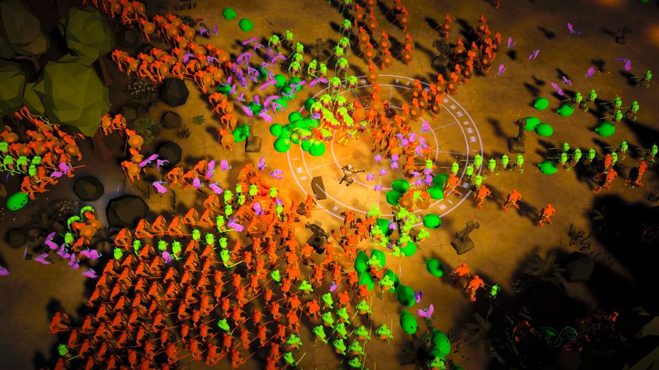
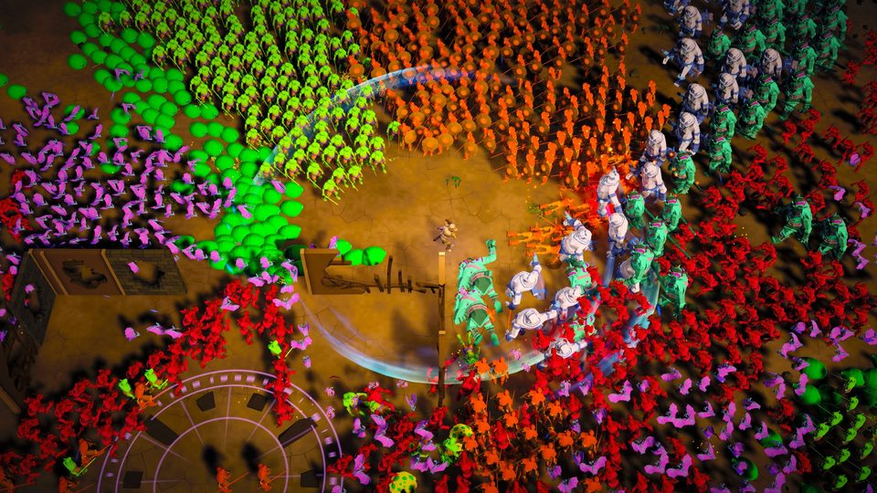
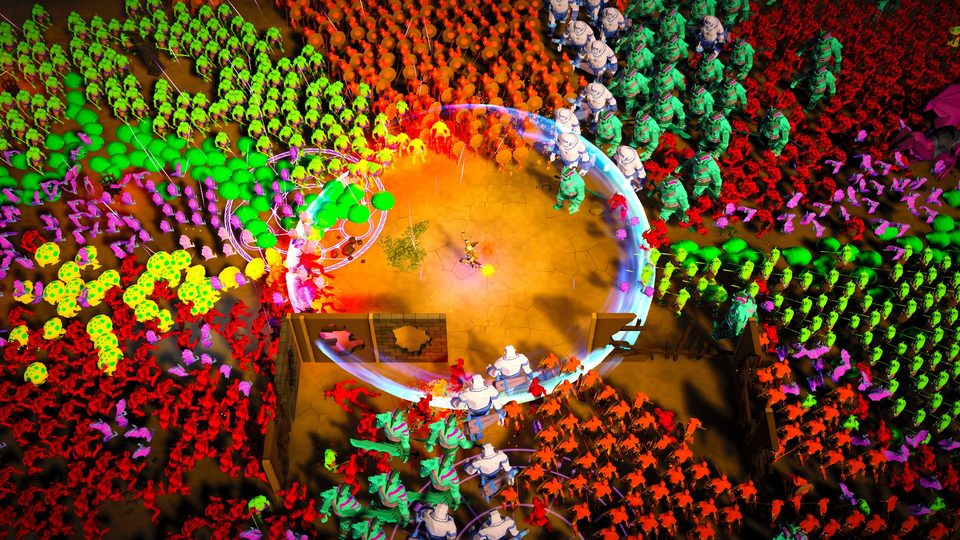
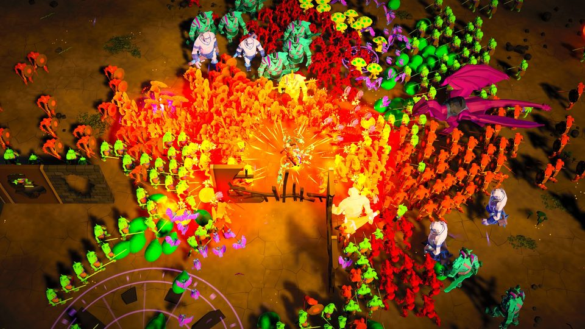
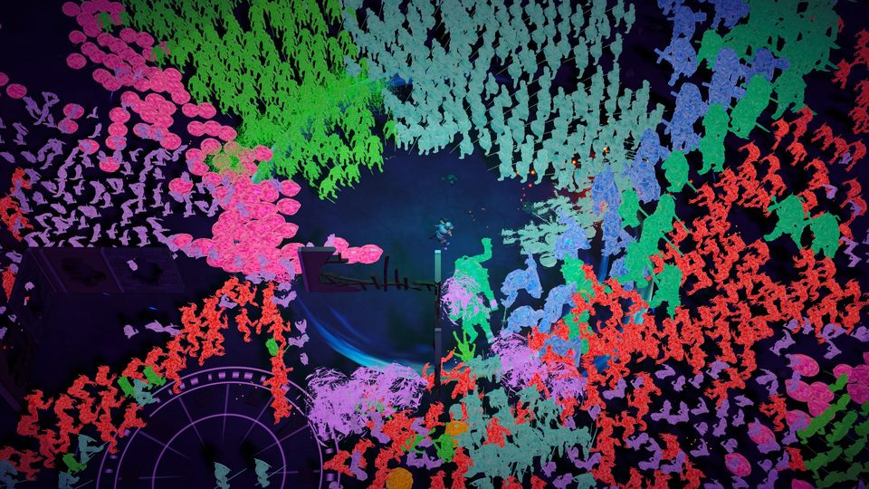
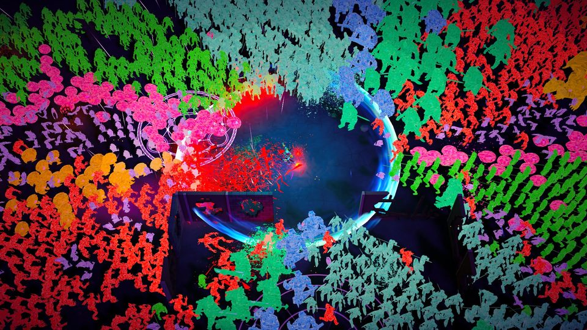

# Overdrive: the foundation (ps-5pd.1)

`--intensity overdrive` merges
[intensity-overdrive.json](../../../Assets/Demo3D/Choreography/Data/intensity-overdrive.json)
over the roster's level script ([choreography.md, Intensity
overlays](../../../../docs/tech-demo-3d/choreography.md#intensity-overlays)).
This is the first cut, tuned only on the timeline's numbers. The tuning bead
owns the overlay from here, and the feel bead owns the client's response.

## The numbers

These are the CLI's tables from
`dotnet run --project demo3d/dotnet/Demo3D.Choreography.Cli -c Release -- song [--level action-level-forest.json] --intensity overdrive`,
run under .NET:

- [report-default-overdrive.txt](report-default-overdrive.txt) and [report-default-normal.txt](report-default-normal.txt)
- [report-forest-overdrive.txt](report-forest-overdrive.txt) and [report-forest-normal.txt](report-forest-normal.txt)

The IL2CPP player's simulation diverges a little from .NET's: 11,632
entities against 14,893. The rhythmic sections on the default script:

| section | swings/s (normal) | kills/swing mean / peak (normal) | spell share | on screen / target (target) |
|---|---|---|---|---|
| drop-1 | 2.34 (1.24) | 11.2 / 28 (2.6 / 6) | 0.14 | 1.05 (510) |
| groove-2 | 2.14 (1.25) | 13.9 / 69 (2.2 / 7) | 0.22 | 0.91 (638) |
| build | 1.83 (1.29) | 6.3 / 14 (1.9 / 4) | 0.69 | 0.94 (638) |
| drop-2 | 2.37 (1.24) | 23.4 / 65 (2.5 / 7) | 0.09 | 0.93 (1020) |
| final-peak | 2.46 (1.25) | 29.5 / 94 (4.1 / 7) | 0.05 | 0.82 (1339) |

The beat is 2.58 per second at 155 BPM.

Against the epic's targets, where the tuning bead starts:

- **Swings:** the hero swings on 70–95% of beats. Spins and slams still take
  two beats each.
- **Kills per swing:** the peaks average 23–30 and reach 94, short of the 40+
  target. The overdrive load asks for 0.06 deaths/s per monster on screen,
  so more kills per swing means a higher rate there.
- **On screen:** the final peak holds about 1,100 (target 1,339), roughly 2.5×
  normal's 427, under views 1.25× wider. At today's widths the screen packs
  out near 60% of the tripled count.
- **Who kills:** the hero takes most kills everywhere except the build. There
  the hero's blows alone reached only about 90% of the build's rate, too close
  to the check's 10% under Mono, so its lightning strikes every second beat.
- **Quiet sections:** they stay at the tripled count. At half that, the final
  peak filled to only 76% of its target.

Every song check passes on the default script under overdrive, in .NET and in
Unity's Mono. They run as "song-overdrive" in TimelineRulesTests, plus
IntensityTests. The forest and heroic scripts miss the on-screen check at
both intensities (forest's build is at 0.67 even at normal). No test runs the
checks on those scripts, and they are tuned on the client's own roster radii.

## Windowless runs

The Mac IL2CPP player ran the whole song in fixed time with stills at 60, 145,
175 and 198 s: `--intensity overdrive`, then the same with `--palette neon
--monster-style crystal`, and normal. Each reached `done at song time 198.00`
with no exceptions. The four missing-script warnings appear in the normal run
too. The effects spawned 15,000 instances against normal's 9,674, with no
pool rejections in the default 2^18-particle pool. Crowd slots, at 16,384 per
type, are far above any type's count.

| | |
|---|---|
|  drop-1, 60 s |  drop-2, 145 s |
|  final peak, 175 s |  normal's final peak, 175 s |
|  neon + crystal, 145 s |  neon + crystal, 175 s |

`--roster forest --intensity overdrive` wasn't run in the player, because the
forest set isn't baked in this worktree. The overlay's load over the forest
and heroic scripts is tested in dotnet.
