# Overdrive: the carnage tuning (ps-5pd.2)

The tuned [intensity-overdrive.json](../../../Assets/Demo3D/Choreography/Data/intensity-overdrive.json)
over the first cut in [../foundation/](../foundation/README.md). Its `note` gives the reasons
for each number; this page has the numbers and stills it was judged by.

## The numbers

These are the CLI's tables, under .NET:

```
dotnet run --project demo3d/dotnet/Demo3D.Choreography.Cli -c Release -- song --intensity overdrive --checks
```

- [report-overdrive.txt](report-overdrive.txt), with every timeline check's verdict at the end
- [report-normal.txt](report-normal.txt), the same song at normal intensity
- [report-forest-overdrive.txt](report-forest-overdrive.txt) and
  [report-heroic-overdrive.txt](report-heroic-overdrive.txt): `--level action-level-forest.json`
  and `-heroic.json` under overdrive

The beat is 2.58 a second at 155 BPM. The rhythmic sections, overdrive against normal:

| section | swings/s (normal) | beats struck | kills/swing mean / peak (normal) | spell share (normal) | on screen / target (target) |
|---|---|---|---|---|---|
| drop-1 | 3.53 (1.24) | 88 of 96 | 11.6 / 125 (2.6 / 6) | 0.06 (0.61) | 1.11 (548) |
| groove-2 | 3.39 (1.25) | 56 of 64 | 13.6 / 113 (2.2 / 7) | 0.03 (0.74) | 0.90 (638) |
| build | 2.58 (1.29) | 16 of 24 | 8.2 / 21 (1.9 / 4) | 0.02 (0.75) | 1.07 (638) |
| drop-2 | 2.34 (1.24) | 87 of 96 | 28.7 / 209 (2.5 / 7) | 0.04 (0.81) | 1.06 (1020) |
| final-peak | 2.50 (1.25) | 62 of 64 | 34.0 / 129 (4.1 / 7) | 0.02 (0.76) | 0.96 (1339) |

"Beats struck" counts the beats with a hero blow (IntensityTests'
`OverdriveFlurriesAddBlowsBetweenTheBeats` prints it). The rest are spin or slam windups and,
in the travelling sections, strides toward the goal with nothing in reach ahead.

Against Decision 3:

- **Every beat.** The hero swings once a beat or more in every rhythmic section. Drop-1, groove-2
  and the build add `slashR@eighth` flurries between the beats, up to 3.5 blows a second. A
  flurry never costs the next beat its blow (the sim skips one that would). Drop-2 and the final
  peak hold ground and strike on 91% and 97% of their beats, one heavier blow each. The combos
  play at 2x to 3x: whole clips, played fast.
- **One blow.** Fodder has one hit point (`hitPointScale` fodder 0).
- **Kills per swing.** The peaks average 29 and 34 a blow, and their biggest blows kill 129 to
  209. Every rhythmic section's biggest blows pass 40 except the build's (21). The 40+ mean was
  reachable, but only by emptying the middle of the screen (below), so the look won.
- **On screen.** Three times normal's counts: the final peak holds about 1,290 of 1,339, three
  times normal's 427. Every rhythmic section's mean is within 11% of its target. Drop-1 and
  the build overfill a little as the horde pours in ahead of the next drop.
- **The hero's kills.** Spells take 2% to 6% in the rhythmic sections, against 61% to 81% at
  normal. The ring, bolts and lightning stay on the phrase and accents, and the final peak keeps
  its laser.
- **Quiet sections** keep their loads at the tripled count. The drops hit harder by load, swing
  rate and width.

## Stills

Windowless `--fixed-time` stills from the Mac IL2CPP player at 50, 98, 145 and 175 s
(drop-1, groove-2, drop-2, the final peak), normal on the left:

| normal | overdrive |
|---|---|
| 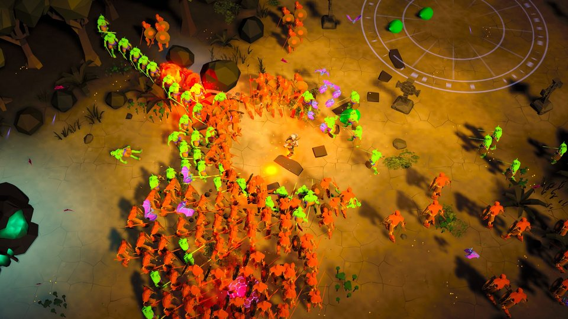 | 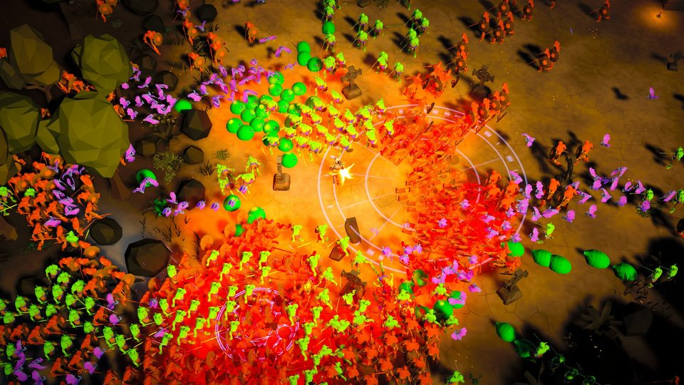 |
| 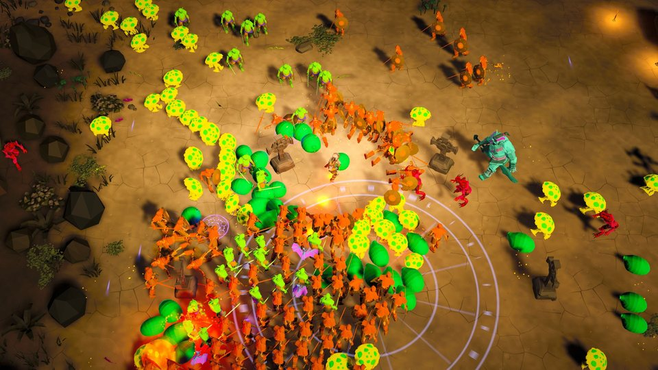 | 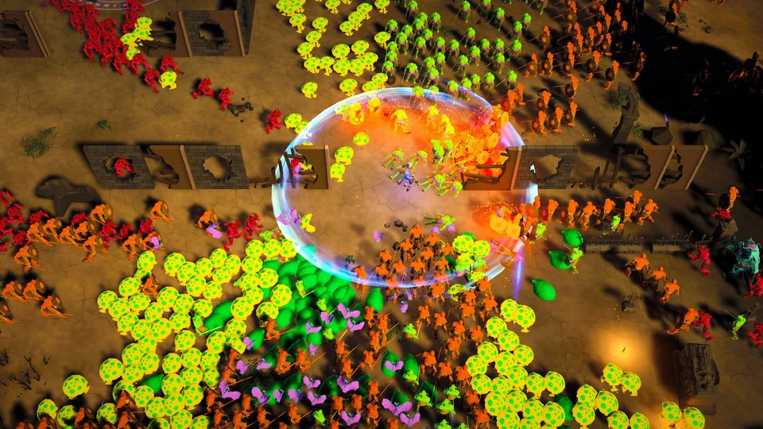 |
| 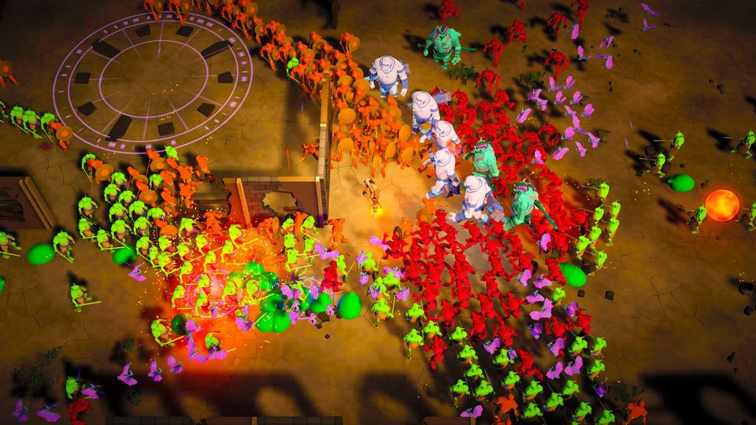 | 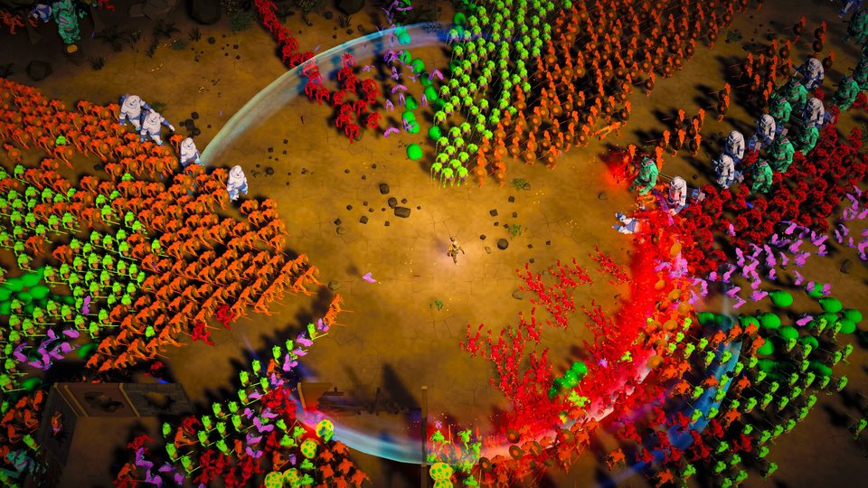 |
| 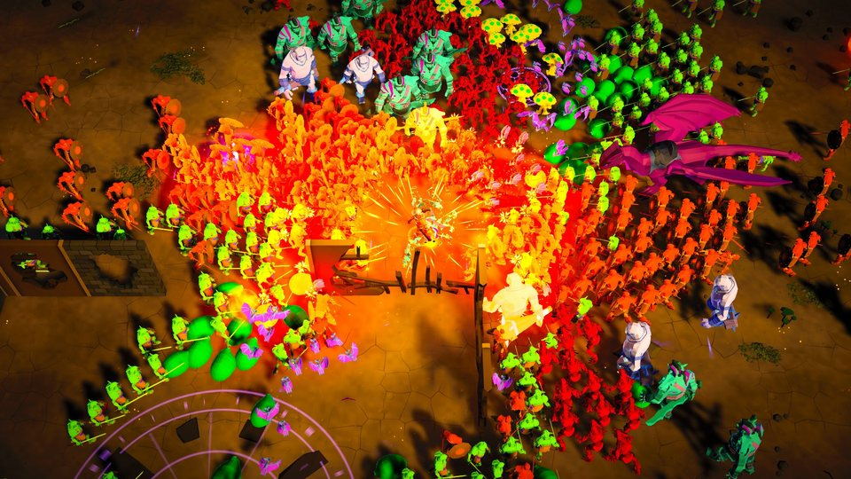 | 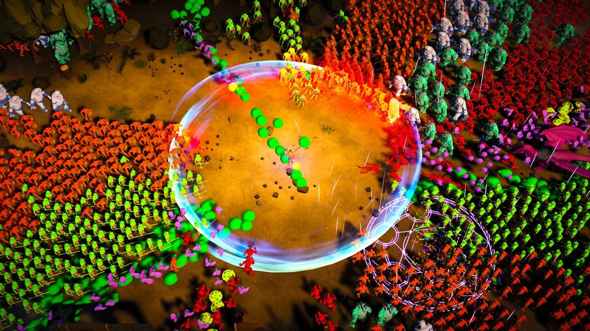 |
| | 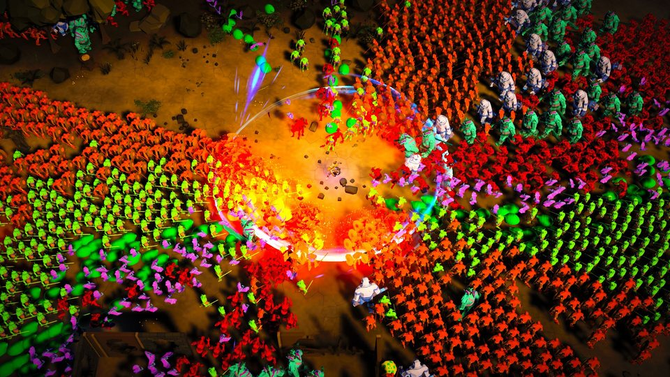 the final peak between sweeps, 165 s |

And `--palette neon --monster-style crystal` under overdrive:
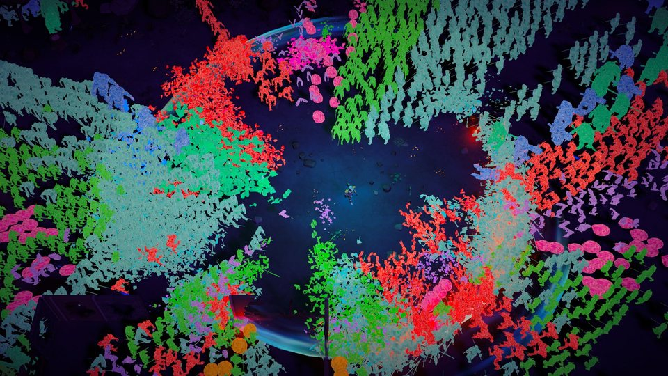 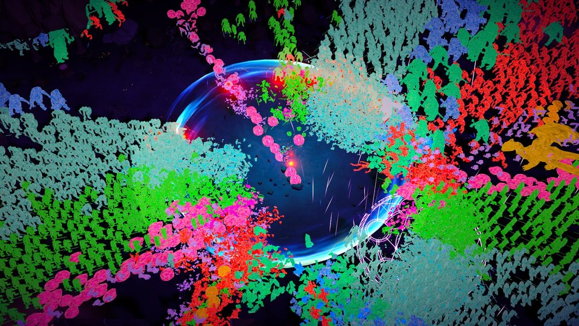

## What limits it

- **Reach against the look.** Monsters walk into the hero's reach and die there, so the hero's
  reach clears a disc, and more kills a second need a wider reach. With hit shapes up to 0.3 of
  the 45 m view and 0.09 to 0.1 deaths/s per monster, the peaks averaged 36 to 46 kills a blow,
  but the stills showed a lone hero on an empty floor, the horde held 10 to 13 m off. Those
  rates also missed on some seeds and drop-2's under Unity's Mono. At 0.2 of the view the peaks
  missed their rates often. The overlay takes 0.25 and 0.07, which hold on every seed tried.
  Right after a ring or slam sweep the peaks still show an empty floor round the hero (drop-2
  at 145 s). Between sweeps the horde presses up to the kill ring (the final peak at 165 s).
  A smaller disc costs kills a blow.
- **Supply.** At the first cut's 37.5 m views the final peak held 70% to 85% of its target.
  The 45 m views give the horde room to fill in as fast as it dies.
- **Flurries against kills per blow.** Flurries in the peaks raised them to about 3.6 blows a
  second, and split the same deaths into fewer a blow, so the peaks swing once a beat and the
  flurries go to the sections before.
- **The build** travels to the courtyard, and its hero alone tops out near 28 deaths a second.
  Its load is 0.035 with two hits a death, so its shapes stay wide and the hero keeps striking
  instead of striding.
- **Spins and slams.** Their windups take more than a beat even at 3x. Between back-to-back
  blows they never fit, so `yieldToAccents` holds back a blow to leave room for them. This song
  has few accents (26) and phrases (20), so they're rare.

## Robustness

The sim is chaotic: a change in the fifth decimal moves where the horde stands. Each candidate
ran on seeds 1 to 7 or 9 (`song --seed N`). The final overlay passes every check on the shipped
seed 1 under .NET and in Unity's EditMode tests (Mono), and every check passes on seeds 1 to 7
too (one had missed groove-2's rate by 11% before its load came down to 0.075).

Some earlier candidates overlapped two monsters at the end of break-2 on a seed in four. That
is a knockback in a free section: the sim pushes a struck monster from where its step ends,
while its neighbour is still mid-step, so dense free breaks can cross two monsters by a third
of a radius. The normal song is too sparse to show it, and fixing it would change normal
timelines, which this epic keeps byte-identical.

## Every roster

The overlay sets its counts and views outright, not as multiples of the roster's script.
Forest's and heroic's scripts draw 150 at 18 m, a real-time cut, and overdrive is recorded
offline. At three times their own counts they missed the song's on-screen check, as they do at
normal. So all three play the same overdrive timeline. The forest and heroic reports match the
default's line for line, and every check passes on all three.
