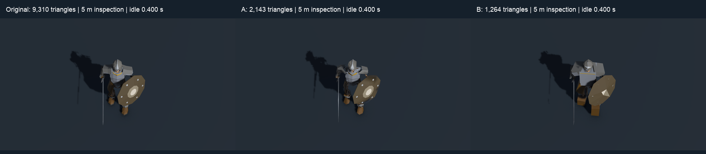
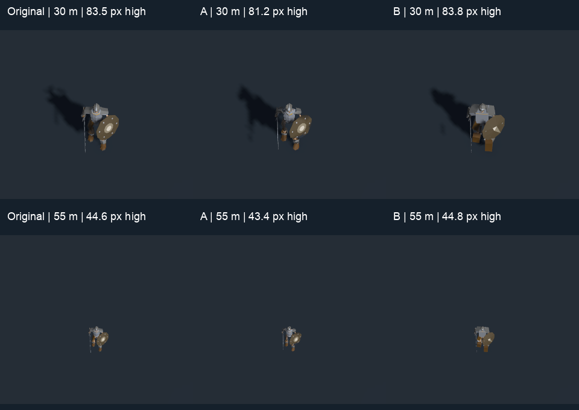
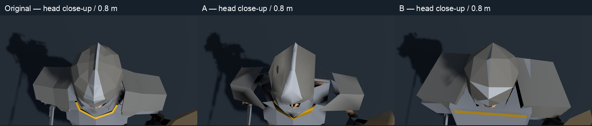

# Skeleton Warrior LOD experiment — Mac / Metal

**Latest comparison:** [B matched to A's measured rendering cost](cost-match.md)
supersedes the unequal-budget strategy assessment below. The new B has 2,003
triangles / 4,211 vertices and supports a part-aware hybrid for aggressive LODs.
The original experiment and its lower-budget B remain documented here.

**Complete.** Both experiments, the synchronized Mac preview, capture checks and relay delivery are complete. Human visual acceptance remains pending. Standalone task
from private relay `b1b4d733cc789d0fae8e3a6e1cd4b1bbd3ea0b70`.
Production LODs, cuts, Windows configuration and normal song entry point stay unchanged.

| Variant | Triangles | Vertices | Material slots | Interpretation |
|---|---:|---:|---:|---|
| Original | 9,310 | 19,217 | 1 | TD5 active combined mesh |
| A | 2,143 | 4,008 | 1 | Nearest retained whole-body reduction; **1,200 target failed** |
| B | 1,264 | 3,792 | 1 | Anatomical replacement, visibly blockier armour |

## Baseline and recipes

Unity 6000.6.7f1, Apple M5 Max, Metal. License verified by cold batch startup.
Manifest sync: 764 files; separate Mac cache records 403,879 vendor files.
The FBX SHA-256 is `de8f13673aade336a5d2ef08ed843e2966d2148d0ce00bc5138bed2198d8644a`.
The original has 120 transform-plus-bind palette entries and 15 actual clips.
TD5 root space, scale, UV0, materials, UV1 palette indices and UV2 weights are retained.
Both candidates reuse the original 60 Hz bone texture. No palette entries are merged.

Source export SHA-256:
`3b04b7bf2930bc4dc86ec0707ce5dc03d2d90317cf3e187b4df9ce318be8b6f9`.
Global positional equivalence finds 192 connected surfaces (touching surfaces can be conflated).
There are 4,991 unique positions at 1 µm and 14,226 extra coincident vertices.
The raw mesh has 19,224 boundary edges. Diagnostic positional equivalence gives
140 globally, but 220 when equivalence is restricted to each source renderer;
nonmanifold counts are 85 and 5 respectively. These identify real open surfaces
versus shading/UV splits, but coincident touching surfaces remain ambiguous;
**global positional welding is not a safe operation**. The local export keeps
all 148 active renderer ranges, source paths, materials, and complete bind matrices.

**A:** [meshoptimizer v0.25](https://github.com/zeux/meshoptimizer/tree/6daea4695c48338363b08022d2fb15deaef6ac09) (MIT), revision
`6daea4695c48338363b08022d2fb15deaef6ac09`. Attribute-aware permissive
simplification, no global border lock and no explicit component removals.
Selective atlas/skin discontinuity protection, plus three positional landmarks
and one original triangle per connected anatomical surface. This final recipe
protects 4,966 source vertices. Twelve combinations: normal/UV/skin weights
`0.1/1/0.8`, `0.03/0.5/0.3`, `0.01/0.25/0.1`, and tolerances
`0.01, 0.03, 0.08, 0.16`. The selected deformation recipe uses tolerance 0.03
and reports 0.0297936 error. All six vertex streams are compacted/remapped.
Skin attributes are continuous weights keyed by palette entry, **never numeric
bone indices**. The 27 most-used weight channels fit meshoptimizer's 32-attribute
limit beside normals/UVs; skin discontinuities and retained original weights
protect the other influences. The final source-surface audit finds none absent.

The early 1,173-triangle A had broken shield mapping. Protecting atlas seams
corrected that at 1,189 triangles, but the coverage audit exposed vanished ribs,
vertebrae and digits. Protecting renderer-level landmarks still allowed small
surfaces inside those renderers to vanish. Per-connected-surface protection
retains the whole body but stops above the comparison band (smallest result
2,055). The retained 2,143 result uses a lower error tolerance. A therefore does
**not** establish a useful 1,200-triangle simplification of the existing topology.

**B:** [Blender 4.5.3 LTS](https://download.blender.org/release/Blender4.5/), GPL-3.0-or-later, build `67807e1800cc`.
Independent LOD0 recipe: skull 130, jaw 50, helmet 80, shield 54, sword 40;
open rib/pelvic shapes reduced within source regions; new five-sided long bones,
independent simplified vertebrae/digits; 12-triangle armour boxes per region/side.
Small bracer/hand/boot straps are consolidated into the armour silhouette.
Explicit allocation totals 1,268; actual output is 1,264 after region reduction.
Every nearest-surface lookup is confined to the anatomical renderer, side or
single digit. Influences accumulate by palette entry, strongest four retained,
clamped and normalized. UVs use complete source face corner triplets, avoiding
interpolation across atlas islands. This preserves discrete colours but can
stretch a small colour feature over a larger face. Worst transfer distances are
0.1265 m at the reconstructed boots and about 0.10 m on chest/shin armour.
Face normals and tangents are regenerated; face splits explain B's vertex count.

Initial B was 1,624 triangles; consolidating straps/digits reached 1,260 but
armour reduction looked torn. A hull trial was rejected. Explicit armour boxes
make B's current silhouette closed and legible, at the cost of oversized shoulders,
square boots/chest and simplified shield markings. It is a prototype replacement,
not a production-ready equivalent. The skeleton's rib/hip openings remain separate
surfaces, although the equipped chest armour hides much of them from the front.

## Reproduce on this Mac

Run from the task worktree root:

```sh
export DEMO3D_CACHE="$HOME/Library/Caches/playlist-survivors/skeleton-lod-mac"
demo3d/tools/recipes/setup_skeleton_lod.sh
uv run --directory demo3d/tools demo3d sync
uv run --directory demo3d/tools python recipes/skeleton_lod.py export
uv run --directory demo3d/tools python recipes/skeleton_lod.py a
uv run --directory demo3d/tools python recipes/skeleton_lod.py b
uv run --directory demo3d/tools python recipes/skeleton_lod.py scene
uv run --directory demo3d/tools python recipes/skeleton_lod.py capture -previewCaptures captures/skeleton-lod-final
uv run --directory demo3d/tools python recipes/skeleton_lod.py build
uv run --directory demo3d/tools python recipes/skeleton_lod.py test
```

The wrapper invokes `/Applications/Unity/Hub/Editor/6000.6.7f1/Unity.app/Contents/MacOS/Unity`
with `-batchmode -force-metal -buildTarget OSXUniversal`. The explicit Mac build
route uses `StandaloneOSX`, Apple Silicon, Mono and `BuildOptions.None`; it never
invokes the Windows Configure/BuildPlayer route. Temporary project and pipeline
settings are restored byte-for-byte by the wrapper. Blender exceptions become
nonzero exits (`--python-exit-code 1`); the pinned DMG hash is checked at setup.

Outputs are local and ignored:

- Scene: `demo3d/Assets/Baked/SkeletonLod/SkeletonLodPreview.unity`.
- App: `demo3d/Builds/SkeletonLodPreview.app`.
- Meshes/data/Blender file/exact per-region budgets/sweep outputs: `demo3d/Assets/Baked/SkeletonLod/`.
- Full captures/reels: `demo3d/captures/`; logs: `demo3d/Logs/`.
- Guard registration: the existing derived-record machinery records everything under Baked before delivery.

Interactive launch (operator only; agent checks stay offscreen):

```sh
open demo3d/Builds/SkeletonLodPreview.app
```

Batch fixed-time player capture, keeping Metal:

```sh
"demo3d/Builds/SkeletonLodPreview.app/Contents/MacOS/Playlist Survivors 3D Demo" \
  -batchmode -force-metal -logFile "$PWD/demo3d/Logs/mac-player-smoke.log" \
  --time 0.4 --view-width 5 --still-out "$PWD/demo3d/captures/mac-player-smoke/idle"
```

Repeatable animation reel: same binary and batch flags, add
`--reel "$PWD/demo3d/captures/skeleton-lod-reel" --reel-fps 30 --view-width 5`.
It saves three registered PNG sequences, one per variant, and exits after the
ordered clip cycle. Loops play twice; nonloops hold 0.6 s at the end. Warmup
frames do not advance the reel clock. Clip order is idle, walk, two roster attacks,
hit, death, then remaining real clips in ordinal name order. The full list is
recorded in the player log. No music or arena assets are loaded.

Space pauses, arrows change clips, O toggles 55°/90°, Tab switches the three
matched views and one registered view, 1/2/3 selects Original/A/B, P captures the
current pose. Sliders control scrub (pauses), speed, facing, zoom and crossfade.
Buttons select 30/40/55 m game views and close inspection. Labels show actual
triangle/vertex counts and projected vertical extent at 1080p, including equipment.
Every camera shares framing, projection, lighting, yaw, scale and animation time.
The preview fixes cuts to none: no automatic LOD, 30 Hz cut or original-mesh
shadow proxy. Each variant casts its own shadow through the real TD5 renderer.

## Verification and limitations

CPU import checks validate indices, finite attributes, discrete in-range palette
entries, normalized nonnegative weights and material/stream counts. Bounds are
recomputed over every vertex at every baked frame; spheres conservatively cover
crossfades too. Existing tests compare the baked skeleton against the original
rig and Unity skinning. Rendering exercises all 15 clips at five phases and
crossfades at 0/0.5/1 through the actual culling/palette/indirect draw path.
The final exercise kept 384 images: 15 clips × (five poses + three crossfade
weights) × three variants, plus eight camera/width combinations × three variants.
The built arm64 Mono player also completed fixed-time captures without opening a
window. A full 718-frame, 15 fps comparison reel (47.867 s) is kept in ignored
`captures/skeleton-lod-comparison.mp4`; its clip clock is deterministic.

| 55° game camera, idle 0.400 s | Original height | A height | B height |
|---|---:|---:|---:|
| 30 m view | 83.48 px | 81.21 px | 83.78 px |
| 40 m view | 61.93 px | 60.25 px | 62.15 px |
| 55 m view | 44.64 px | 43.43 px | 44.81 px |
| 5 m inspection | 542.19 px | 526.74 px | 543.44 px |

These are projected vertical bounds of all deformed vertices, including equipment,
at 1080p. They use the original baked matrices, exact interpolation, root space,
facing and camera projection; the UI computes the current pose too. A native-pixel
crop is kept below so small game views are not judged from an enlarged model.

**Visual assessment (agent, not operator acceptance):** A is recognizably closest
to the original at roughly 43–62 px; at about 81 px and above, its hollowed shoulder
plates, faceted helmet, sharper limbs and shield shading are visible. Its teeth,
ribs and digits now remain, rather than disappearing behind the armour. B remains
recognizable at roughly 45 px, but its square chest/boots, large shoulders and
simplified shield boss are a distinct style even there; no equivalence threshold
is claimed for B. At 83 px and at inspection scale its armour is visibly crude.
Both follow the available attack, hit, death, collapse and reassembly motion;
no unexpected detached weapon, invalid palette colour, culling disappearance or
missing cast shadow was seen in the kept pose/contact-sheet checks. Deliberate
collapse/reassembly parts are present in the original too. This is sampled visual
inspection, not a proof that every continuous pose is defect-free.




[Clips 1–5](clips-1.png), [clips 6–10](clips-2.png), [clips 11–15](clips-3.png)
show the midpoints of every available clip. Full pose/crossfade captures stay local.

Assemble the labelled reel without optional ffmpeg text filters:

```sh
uv run --directory demo3d/tools python recipes/skeleton_lod_reel.py --fps 15
uv run --directory demo3d/tools python recipes/skeleton_lod_evidence.py
```

Use `--reel-fps 15` on the player when reproducing that exact 718-frame reel.
The kept geometry is the same as the final build; the later UI review fixes do
not change its animation or meshes.

Windows/D3D12 parity, Windows IL2CPP builds, Cygnus checks and Windows GPU performance
budgets are not run on this Mac. The Metal comparison establishes neither
production equivalence nor a performance gain. Human visual acceptance is pending;
the interactive app is supplied for that judgment.

## Self-review before cold review

- Downstream needs: reread the handoff; isolated scene/library, original bone path,
  all real clips, synchronized controls, Mac route, vendor guard and relay delivery implemented.
- Claims: counts/settings come from retained local exports/recipes/logs. The failed
  1,200-triangle A attempt is explicit. Final screen-size claims await final stills.
- Edge cases: Blender errors propagate, material count >1 is explicitly rejected
  by B's current recipe, all vertex streams remap, extra clips have stable order,
  nonloops clamp/hold and loops wrap. Mac settings restored after Unity processes.
- Tests against source: existing rig-versus-Unity-skinning tests passed; real crowd
  renderer captures exercise exported meshes, not a second preview renderer.
- Concurrency: no added workers/channels. GPU readbacks drain before explicit
  disposal in editor capture (editor-only objects do not reliably receive OnDestroy).

## Cold review and check record

A fresh read-only warden subagent reviewed the implementation and existing renderer.
Both confirmed findings were fixed: paused Next/Previous now selects the new pose
immediately, and single-view controls use a smaller image plus a bounded scroll
area. A regression check exercises paused selection against the real preview bake.
That regression also exposed cleanup ordering: cameras now detach their target
textures before disposal. No confirmation review was requested.

Final validation:

- 119 .NET tests passed.
- 68 Python tests passed; 2 Windows-only tests skipped. Full tools lint passed.
- Cold Unity EditMode: 197 passed, 0 failed, 7 skipped because unrelated production
  arena/effect/crowd bakes are absent in this isolated project. The new paused-clip
  regression passed against the real preview library.
- The Mac arm64 Mono/Metal non-development build passed. The final player completed
  offscreen fixed-time captures; all three PNGs exist. No camera-target disposal
  error or persistent-allocation leak appears in the final capture check.
- Full final renderer exercise: 120 recorded pose/crossfade states over 15 clips,
  three variants; 384 intended stills including the camera/width comparisons.
- `CHANGES_BASE=b1b4d733cc789d0fae8e3a6e1cd4b1bbd3ea0b70 scripts/check-fast` passed.
- Vendor guard passed on the staged tree and the private-relay pre-push check.
  All project/pipeline settings restored; production configuration has no diff.
- No Windows-only result is counted as a pass. No Cygnus connection was used.

Implementation checkpoint: `0850eedc419e475653817337eb7e4eacebdef5bf`.
Final comparison notes follow it in a documentation-only relay commit.

Tool note: the installed ffmpeg lacks the optional `drawtext` filter; the first
labelled-video command failed with `No such filter: 'drawtext'`. The tracked reel
assembler now draws labels with Pillow and streams raw frames to ffmpeg; the
complete 47.867 s H.264 output was generated successfully. No guard was bypassed.

## Preview UI follow-up (2026-10-28)

The operator reported repeatedly overprinted labels in the full-screen player.
All three model cameras targeted textures, leaving no camera to clear the screen
behind the changing IMGUI text. The preview now has an empty screen camera that
clears colour every frame, and the GUI paints its own opaque background before
labels and controls. A regression fills its target with different old pixel
colours and confirms the next render erases them independently of that content.
After the batch checks, the operator-requested full-screen app was reopened and
its live changing text was visually inspected: the labels were sharp and separate.

Zoom now reaches **0.5 m view width**, five times closer than the old 2.5 m limit.
Use the wheel over a model, **+/-**, or the logarithmic zoom slider. **Head close-up**,
**Torso close-up** and **Feet close-up** buttons also move the camera's focus to
that region, identically for all variants. The **Inspection focus height** slider
lets you move the close-up vertically; **Whole body** returns to the 5 m view.
**Tab** still enlarges a single registered view and **1/2/3** switches variants.
Meshes, animation, materials, counts and production settings are unchanged.



The current app is in the follow-up worktree:
`/Users/dthurn/playlist_survivors/.worktrees/skeleton-lod-ui/demo3d/Builds/SkeletonLodPreview.app`.
Launch it full screen at a close upper-body view:

```sh
open -n demo3d/Builds/SkeletonLodPreview.app --args -screen-fullscreen 1 \
  --view-width 1.2 --focus-height 1.25
```

Regenerate the twelve head/torso/feet/minimum-zoom captures with
`uv run --directory demo3d/tools python recipes/skeleton_lod.py details`.
Full-resolution renders stay in ignored `demo3d/captures/skeleton-lod-details/`.

Follow-up checks: three focused regressions passed, then cold Unity EditMode
**199 passed, 0 failed, 7 unrelated production-bake skips**; .NET **119 passed**;
Python **68 passed, 2 Windows-only skips**; tools lint and the Mac arm64 Mono/Metal
non-development build passed. The head, torso, feet and 0.5 m renders were visually
inspected. A temporary batch-player backbuffer screenshot probe returned black
(the UI is not presented in that mode); it was rejected as evidence and its
unshipped capture route was removed. The regression uses explicit RenderTextures,
and the already requested interactive full-screen launch supplied the live UI
check. No routine Unity editor window was opened and Cygnus was not used.
