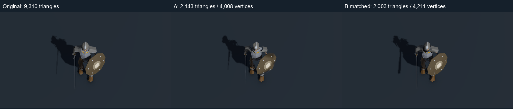
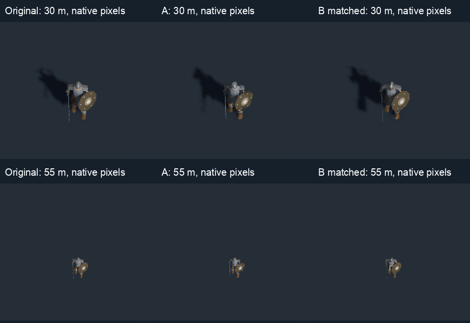

# Skeleton LODs: comparison at comparable rendering cost

**Recommendation: use a part-aware hybrid for aggressive crowd LODs.** Preserve
important authored shells, simplify them with separate budgets, and reconstruct
selected thin bones and tiny details. Use lighter source-mesh reduction for nearer
LODs and keep LOD0 where damage is visible. This recommendation concerns the asset
pipeline; production LODs/defaults have not changed.

The new B is **2,003 triangles / 4,211 vertices**, versus A's **2,143 / 4,008**.
This replaces the earlier unequal 1,264-versus-2,143 comparison. Both use one material,
the same 120-entry transform-plus-bind palette, 60 Hz clips, four skinning slots,
shader, culling and own-mesh shadows. The older low B remains available as B.json;
B-matched.json is built independently from LOD0, not inflated from the old proxy.

## Result

B's median paired synchronized render latency is **1.013 × A** across 36 paired
blocks. The 12 scenario medians of paired ratios range from **0.985 to 1.072**.
Individual paired blocks range from **0.894 to 1.119**: these millisecond measurements
are noisy, so this supports comparable cost, not an exact speed tie or speed win.

At actual game sizes, B is closer to Original:

| Game view (about character height at 1080p) | A silhouette overlap | B silhouette overlap | A foreground RGB error | B foreground RGB error |
|---|---:|---:|---:|---:|
| 30 m (~83 px) | 87.76% | 92.17% | 0.07564 | 0.06059 |
| 40 m (~62 px) | 87.64% | 92.17% | 0.07220 | 0.05797 |
| 55 m (~45 px) | 87.55% | 91.98% | 0.06843 | 0.05561 |

Across 270 registered poses, B has better silhouette overlap in **267/270** and
lower foreground RGB error in **263/270**. RGB error is about 19–20% lower on average.
These are uncalibrated image comparisons, not a perceptual acceptance threshold.
Silhouette includes internal openings as well as the outer contour. The colour
metric includes material/shading differences on the union of visible character
pixels; it does not separately score the cast shadow or off-foreground pixels.




B's biggest improvement comes from spending the budget deliberately: its shield
body and central boss were already only 76 triangles, so it keeps them intact and
rebuilds the six tiny rivets at 8 triangles each. Its shoulder shells stay separate
and retain a more complete contour. The older recipe's box armour is gone. B still
has a faceted helmet, angular collar and simplified limb/digit geometry visible
when enlarged. A has conspicuous shoulder/helmet holes and more shield distortion.
Neither result is a close-camera replacement for LOD0.

## What the recommended pipeline means

1. Keep the original rig, transform-plus-bind identities, UV/material seams and
   authored large surfaces. Simplify each semantic part with a screen-space budget.
2. Preserve cheap, visually dominant shapes. A blanket whole-mesh target spent
   triangles on tiny details while damaging the shield and armour.
3. Replace expensive small anatomy selectively, using region-limited skin transfer;
   keep necessary articulation and negative spaces. Maintain a per-type recipe.
4. Compact all streams, measure vertices as well as triangles, and gate each LOD
   with animation/colour/silhouette/shadow comparisons at its intended screen size.

The new B is a **hybrid**: it uses the same meshoptimizer simplifier as A for its
retained shells, plus authored allocation rules and reconstructed small anatomy.
The evidence favours that allocation/retention strategy for this skeleton. It does
not establish that primitive reconstruction of every surface is desirable, or that
Blender is a better simplifier than meshoptimizer. Other roster types still need
per-type tuning and acceptance checks. No universal pixel switch threshold is
inferred from one character, and human aesthetic acceptance remains pending.

## Timing protocol

A non-development arm64 Mono player runs in Mac batch mode on Apple M5 Max / Metal,
with no foreground window. One real crowd render occurs per player Update.
Each timed sample includes instance upload, culling, palette blending, real indirect
main/shadow submissions, URP passes and GPU completion. A one-pixel readback and
counter drain synchronize completion. This is **CPU submission plus GPU completion
latency**, not GPU-only timing or a complete game's frame time.

- 1,024 and 4,096 instances; 30/55 m views; walk, attack and hit/walk crossfade.
- Three blocks per scenario, Latin-square Original/A/B order; 8 warmup and 24 timed
  frames per block. All raw timings are retained (108 rows / 2,592 timed frames).
- 1920×1080 RenderTextures, MSAA4, 55° pitch / 30° FOV; identical deterministic
  positions, facing, scale, clip times and crossfades; cuts disabled.
- All three variants use the union of their clip bounding spheres for timing.
  Every recorded row has exactly N visible and N shadow-casting instances and
  two RenderMeshIndirect submissions (main bins and shadow) for its one material.
- Per-scenario A/B medians below are calculated separately across the three blocks.
  Paired B/A is the median of the three within-block ratios; these statistics can
  differ when a noisy block changes the ordering of the separate medians.

| Instances | View | Pose | A median ms | B median ms | Paired B/A |
|---:|---:|---|---:|---:|---:|
| 1,024 | 30 m | walk | 2.903 | 2.997 | 1.016 |
| 1,024 | 30 m | attack | 2.792 | 3.085 | 1.008 |
| 1,024 | 30 m | crossfade | 2.819 | 2.820 | 1.001 |
| 1,024 | 55 m | walk | 2.462 | 2.545 | 1.042 |
| 1,024 | 55 m | attack | 2.542 | 2.577 | 1.017 |
| 1,024 | 55 m | crossfade | 2.430 | 2.494 | 0.985 |
| 4,096 | 30 m | walk | 9.825 | 10.082 | 1.022 |
| 4,096 | 30 m | attack | 9.718 | 9.981 | 1.008 |
| 4,096 | 30 m | crossfade | 9.718 | 10.236 | 1.053 |
| 4,096 | 55 m | walk | 8.838 | 8.905 | 1.007 |
| 4,096 | 55 m | attack | 8.582 | 9.197 | 1.072 |
| 4,096 | 55 m | crossfade | 8.210 | 8.699 | 1.008 |

These Mac measurements establish comparability under this controlled workload.
Windows/D3D12, production FX/lighting/cuts and the RTX target's GPU budget were not
measured; Cygnus was not used. GPU completion/readback overhead is included equally
but limits fine-grained conclusions. A release-device benchmark is still needed
before selecting production thresholds.

## Quality protocol and limitations

15 actual clips × phases 0.25/0.5/0.75 × front/rear facing × 30/40/55 m = 270 poses,
each compared for A and B (540 rows). The original and candidates render through
the real crowd path with identical camera and animation state. An ID-white shader
mode supplies character masks; the centre 512×512 crop is checked for foreground
at its border and missing foreground. RGB error uses the corresponding lit image.
The all-clip capture exercise also checks endpoints and preceding crossfades at
0/0.5/1; full resolution renders stay local. These sampled checks do not prove every
continuous pose defect-free, and the quality scores do not measure artistic taste.

## Reproduce and inspect

From this task's Mac worktree (pinned tools installed by the earlier setup script):

```sh
export DEMO3D_CACHE="$HOME/Library/Caches/playlist-survivors/skeleton-lod-mac"
uv run --directory demo3d/tools python recipes/skeleton_lod.py b-match
uv run --directory demo3d/tools python recipes/skeleton_lod.py scene \
  -bCandidate Assets/Baked/SkeletonLod/B-matched.json -bLabel 'B matched'
uv run --directory demo3d/tools python recipes/skeleton_lod.py build
uv run --directory demo3d/tools python recipes/skeleton_lod.py cost \
  --cost-out "$PWD/demo3d/captures/skeleton-lod-cost/results.json"
uv run --directory demo3d/tools python recipes/skeleton_lod.py quality
uv run --directory demo3d/tools python recipes/skeleton_lod.py capture \
  -previewCaptures captures/skeleton-lod-matched
uv run --directory demo3d/tools python recipes/skeleton_lod.py details
uv run --directory demo3d/tools python recipes/skeleton_lod_cost_report.py
open -n demo3d/Builds/SkeletonLodPreview.app --args -screen-fullscreen 1 --view-width 5
```

The recipe defaults to budget scale 0.75 (`SKELETON_B_BUDGET_SCALE` overrides it).
It uses meshoptimizer v0.25 / `6daea4695c48338363b08022d2fb15deaef6ac09` (MIT) and
Blender 4.5.3 LTS (GPL-3.0-or-later). Geometry is generated from the original export.
Every source shell component gets a retained triangle and its own allocation;
the generator rejects an erased component. Proxy transfers stay within one body
region/side/digit/rivet. Only fully identical float32 vertex streams are shared.
Unity import checks all attributes/indices/weights and recomputes bounds using
every vertex of every baked frame. Full recipes, models and all derived assets
stay in ignored Assets/Baked/SkeletonLod; the original low-B files remain there.

The preview app is `demo3d/Builds/SkeletonLodPreview.app` in
`/Users/dthurn/playlist_survivors/.worktrees/skeleton-lod-cost-match/`.
The scene is `demo3d/Assets/Baked/SkeletonLod/SkeletonLodPreview.unity`.
Its third pane is labelled **B matched**. Existing full-screen, zoom, region focus,
clip and registered-view controls remain available.

Aggregate data and source/output/raw-file hashes are in
[cost-match-summary.json](cost-match-summary.json). Raw timings/quality rows are in
ignored `demo3d/captures/skeleton-lod-cost/{results,quality}.json`; all earlier
superseded trial files are labelled as such there. The controlled 2,003-triangle
B above is the only candidate used for this final table and recommendation.

## Self-review before cold review

- Downstream needs: done. Re-read the handoff, user cost-equivalence request and
  TD11's existing cut/fidelity notes. Same skinning path and cuts for timing;
  matched game-size comparisons and a new labelled preview; no production changes.
- Claims: done. Counts and hashes come from kept assets; 108 cost rows and 540
  quality rows validate before report generation. Timing scope/noise, metric
  limitations, Mac-only scope and pending human judgment are explicit.
- Edge cases: done. Bounds equalized for timing, actual visible/shadow counts
  checked, failed GPU readbacks abort, startup/frame exceptions exit nonzero;
  dropped shell components reject generation, discrete palettes never averaged.
- Tests against source: done. Quality compares against real Original renders,
  not the new tool against itself; source rig/Unity-skinning tests and importer
  checks cover original binding. Full regressions passed before delivery.
- Concurrency: no new worker threads/channels. One timed render per player Update;
  GPU readbacks drain before buffers/material/shader copies are disposed.

## Review and validation

A fresh read-only same-host review applied the cached warden instructions and
reported no actionable findings. The skill file disappeared during the session;
the instructions read earlier were supplied verbatim to complete the review.
Raw hashes/counts, timing ratios, quality summaries, isolation and ignored derived
outputs were checked independently.

- Cold Unity EditMode: 199 passed, 0 failed, 7 unrelated production-bake skips.
- .NET: 119 passed. Python: 68 passed, 2 Windows-only skips. Tools lint passed.
- Normal arm64 Mono/Metal Mac build passed; all-clip/crossfade and detail renders
  completed. Cost and quality runs produced the validated raw outputs above.
- Final check-fast and vendor guard passed before private-relay delivery.
- No Windows/D3D12, Windows IL2CPP or Cygnus checks were run.
