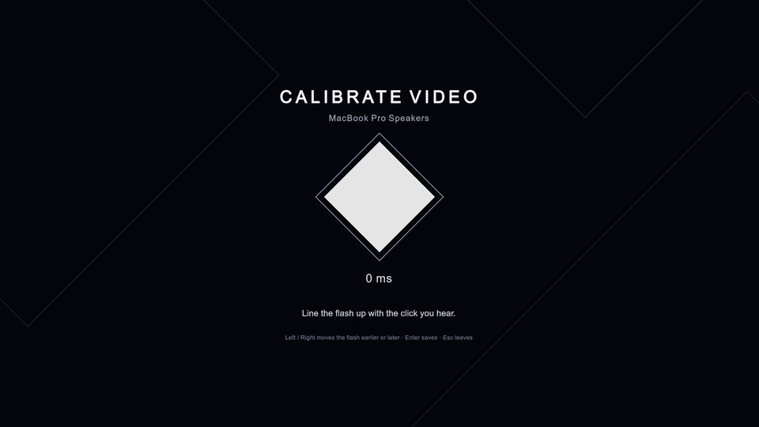
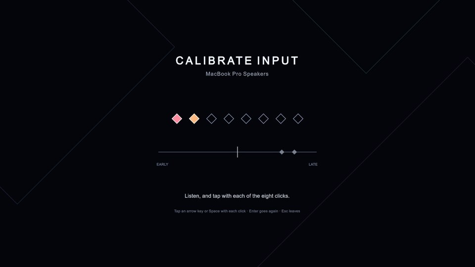
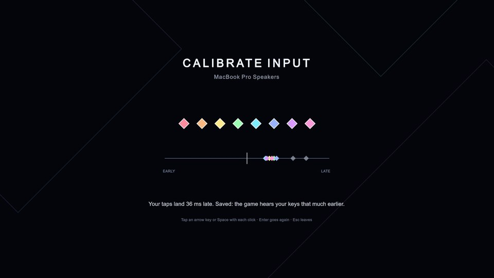
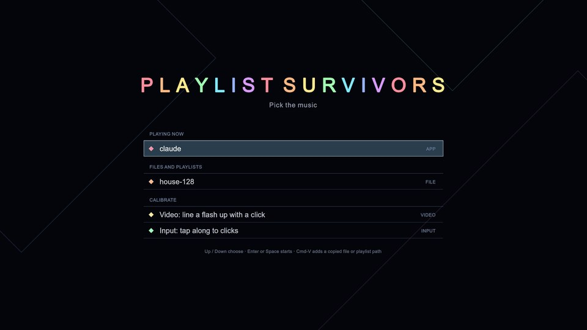
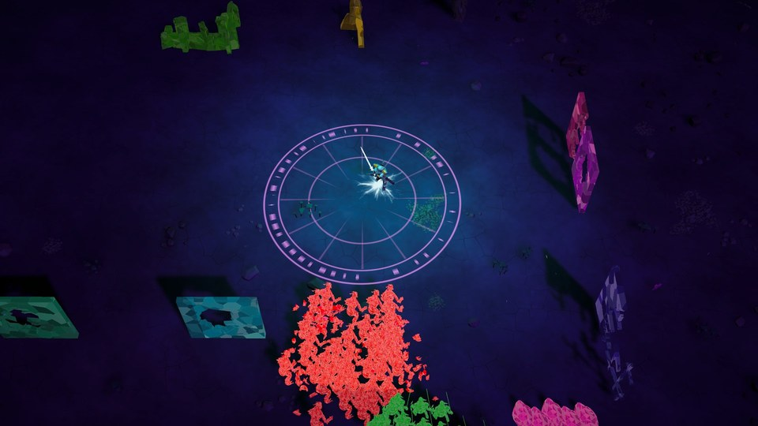
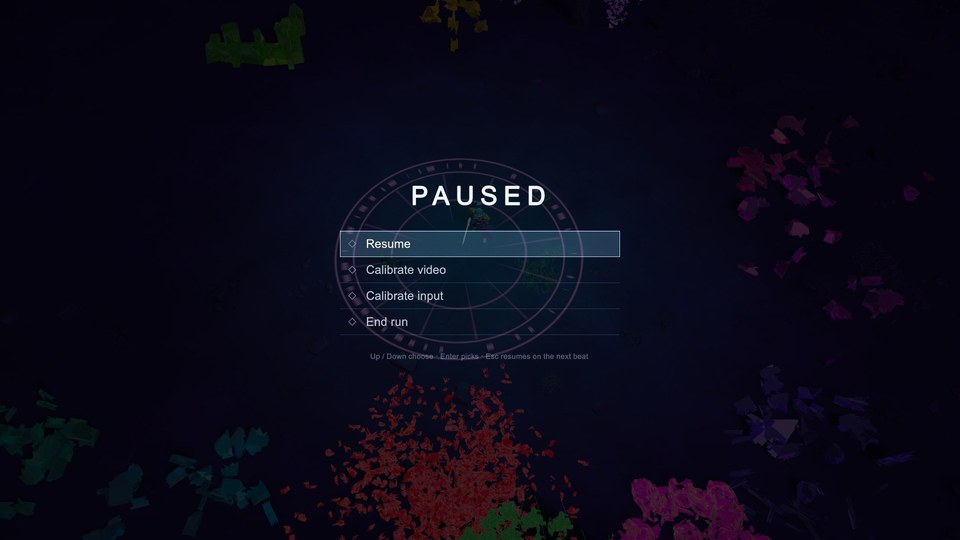

# Calibration and the pause menu (ps-msz.6.11)

The video and input calibrations per output device, their screens from the title screen and the
pause menu, and the pause menu itself (docs/archive/design/unity-game.md, "Calibration", Shipped
(ps-msz.6.11)). 2026-10-31, jarvis (MacBook Pro Speakers at 48 kHz), the IL2CPP player. The
clicks, the flash and the keys need a window and the speakers: those checks are the operator's
rows in [operator-pending.md](../operator-pending.md).

```sh
EXE="game/Builds/mac/il2cpp/PlaylistSurvivors.app/Contents/MacOS/Playlist Survivors"
L() { uv run --project demo3d/tools game look "$@"; }
```

## The screens

Under `--fixed-time` a screen's song time is the frames' since it opened and no click plays, so
the first click (and flash) is at 1.0 s. A batch-mode panel's target holds the previous frame's
UI when a still is kept, so each still shows the frame 1/60 s before its name's time.

| Still | Command |
|---|---|
|  | `L calibration-video --at 1.017,1.067 --player-args "--calibrate video --calibration /tmp/c.json"` (the flash's frame) |
|  | the same, 50 ms after the click: the flash fades over 150 ms |
|  | `L calibration-input --at 1.6,6 --player-args "--calibrate input --tap-along 90,70,34,41,28,45,30,38 --calibration /tmp/c.json"`: two warm-up taps on the scale, grey |
|  | the same at 6 s: eight gems tapped, the counted taps' errors in colour, 36 ms saved |
|  | `L calibration-title --at 1.5 --player-args "--title --music-dir DIR"`: the CALIBRATE rows under the files |
|   | `L calibration-pause --at 7.5,9 --player-args "--file $PWD/public/reactive/house-128/house-128.ogg --pause-at 8"`: the run, then paused at 8 s under the menu, drawn over the frozen world |

The pause run's summary: `run Playing from song 3.780 s, run clock 4.303 s, 1 freezes, 1 run
controls`. The run clock stopped at the pause (8.08 - 3.78 s) and stayed there to 9 s.

## The tap-along's offset, and a run reading it

| Run | Result |
|---|---|
| The input still above, fixed time, taps 90, 70, 34, 41, 28, 45, 30, 38 ms late | `input saved: video 0 ms, input +36 ms from 8 taps`, the median of the six after the first two; the file has `"uid": "BuiltInSpeakerDevice", "name": "MacBook Pro Speakers", "inputMs": 36` |
| `"$EXE" -batchmode --calibrate input --tap-along 20,20,52,61,48,65,50,58 --calibration /tmp/rt.json --headless --seconds 7`: real time, the clicks on the DSP clock | output latency 38.0 ms (the device's reported latency plus Unity's buffering, as the sync spike measured), `input +55 ms from 8 taps` |
| `"$EXE" -batchmode --file .../house-128.ogg --calibration /tmp/rt.json --headless --seconds 5` | `GameLoop: calibrated for MacBook Pro Speakers (BuiltInSpeakerDevice): video 0 ms, input +55 ms` |

EditMode tests (Game.Tests.CalibrationTests): the tap-along's median and quarter-beat window,
the input offset hearing keys that much earlier, a video offset showing a flash that much
earlier, per-device storage (round trip, whole milliseconds, an uncalibrated device, an
unreadable file), and `ps_device`'s layout and the plugin's report. The plugin's header and C
interface tests cover `ps_output_device`.

Not checked windowless: hearing the clicks against the flash, tapping real keys, the pause menu's
keys and clicks, and a Bluetooth device (its notice and its own calibration).
