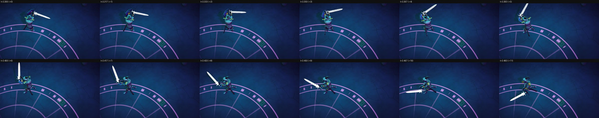
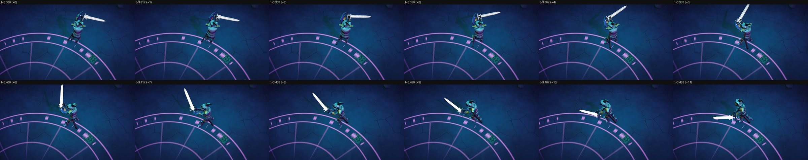
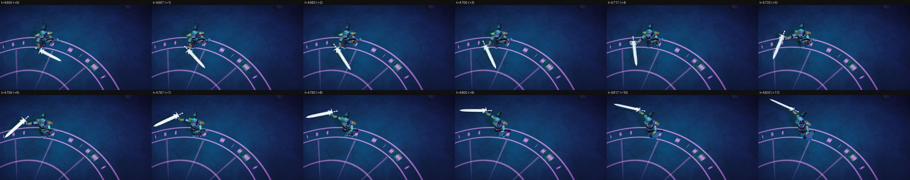
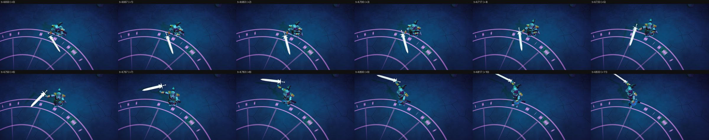
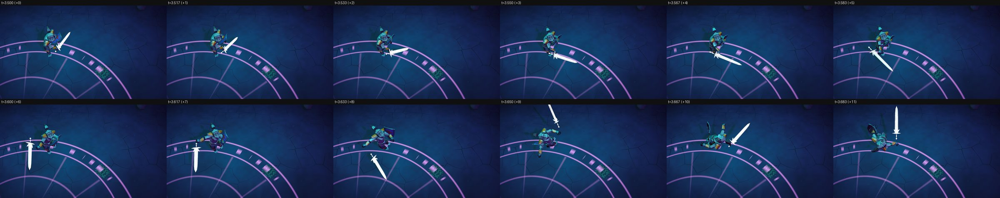
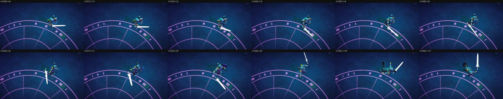

# The hero (ps-msz.3.10)

The Synty knight on a song-time playable graph, hopping on its strides, its attacks retimed onto
the sim's impacts, with the white crystal blade ([the design](../../../docs/design/unity-game.md),
The Hero; Attacks and Steps Land on the Beat). The code is game/Assets/Game/Client/Hero/:
`HeroMotion` (the motion as a function of the HeroStep and Attack events and the song time),
`HeroClips` (the clip table, game/Content/hero-clips.json, and the retiming), `HeroRig` (the
graph), `HeroBlade` and Game/CrystalBlade, and `HeroPresenter`, which the frame loop subscribes
when the build has the hero bake (`game unity BakeHero`, or `game build`). The look's camera now
follows the hero as drawn.

## How it was run

On the Mac (jarvis), the Mono player, fixed time (frame n is song time n/60), no music: the hero's
events come from synthetic feeds, written by [feeds.py](feeds.py). For each tempo,
hero-BPM.jsonl strikes on beats 1 to 10 from 1 s (slashes left and right, a follow-up on the
eighth after beats 3 and 6, spins on beats 4 and 10, a slam on beat 7), each winding up 0.32 s
ahead or from the impact before, as the sim's sword does; hero-BPM-steps.jsonl adds strides on
the stride grid (0.3, 0.234 and 0.4 s), a tile east and back, with a bump and a late stride.
`--view-width 8` frames the knight close. From the worktree's root:

```sh
python3 game/evidence/hero/feeds.py
E="$PWD/game/evidence/hero"; C="$PWD/captures/game/hero"
uv run --project demo3d/tools game look hero-100 --backend mono --at 3.3 --frames 12 --strip 6 --evidence hero --player-args "--events $E/hero-100.jsonl --view-width 8"
# likewise hero-100-steps at 3.3, hero-128 and hero-128-steps at 4.65, hero-150 and hero-150-steps at 3.5
EXE="game/Builds/mac/mono/PlaylistSurvivors.app/Contents/MacOS/Playlist Survivors"
"$EXE" -batchmode -force-metal -logFile $C/run-hero-128-steps.log --fixed-time --events $E/hero-128-steps.jsonl --seconds 7 --hero-out $C/hero-128-steps.csv
python3 game/evidence/hero/feeds.py check $E/hero-128-steps.jsonl $C/hero-128-steps.csv
```

`--hero-out` writes each frame's position, lift, yaw, clips, times, weights and the blade's flare;
the CSVs stay in the gitignored captures/game/hero/.

## Results

- **Every impact lands on its frame, at all three tempos, with and without stepping.** `feeds.py
  check` reads each run's CSV: for all 12 attacks of each of the six feeds (72 in all), the first
  frame at or after the sim's impact shows the attack's clip at or just past its measured impact
  (the peak speed of the sword hand) and the frame before short of it, with the attack whole on
  the upper body and the blade's flare rising from that frame (1, or 1.5 for a heavy blow). At
  100 and 150 BPM every beat is a frame; at 128 BPM (beats 28.125 frames apart) the impact frame
  falls 0 to 14.6 ms after the beat, and the clip is 0 to 0.016 s past its impact there, which is
  that gap at the clip's speed. A swing that the next winds up from (a main strike before its
  follow-up, a follow-up before a spin) holds 87 to 96% of the attack on its impact frame while the
  next starts crossfading in.
- **Retiming covers the speed range.** The EditMode test `HeroTests.RetimingLandsTheImpactOnTheImpactsFrameAcrossTheSpeedRange`
  fits every attack clip to wind-ups asking for 0.5x to 2x (past 0.75x to 1.33x both ways), at
  three frame phases, light and heavy: the clip's impact frame is always the impact's frame. Its
  neighbours check the part-way entry of a short wind-up, the follow-up's crossfade from the swing
  before (which keeps its impact), the clip chosen for each kind, the hop's shape and facing, and
  the flare.
- **The strips** (12 consecutive frames, the impact at +6):
  - [hero-100.jpg](hero-100.jpg), [hero-100-steps.jpg](hero-100-steps.jpg): the heavy spin on
    beat 4 (3.4 s), entered part-way at its wind-up (it would need 4.5x from the start), the blade
    flaring white on 3.400; stepping, the knight hops a tile east and back through it (its strides
    start on beats and half-beats, so each impact lands as a 14 cm hop takes off).
  - [hero-128.jpg](hero-128.jpg), [hero-128-steps.jpg](hero-128-steps.jpg): the right slash on
    beat 8 (4.75 s, the one 128 BPM beat in ten that is a frame), aimed south-west.
  - [hero-150.jpg](hero-150.jpg), [hero-150-steps.jpg](hero-150-steps.jpg): the follow-up on the
    eighth after beat 6 (3.6 s), the combo's right slash retimed into the 0.2 s gap, then the slam's
    wind-up turning the knight south.
- The hop: the Synty packs have no hop short enough (their jumps run about a second), so a hop is
  the run clip's half-cycle, one foot then the other, over the step's 110 ms with a parabolic lift.

| Strip | |
|---|---|
| 100 BPM |  |
| 100 BPM, stepping |  |
| 128 BPM |  |
| 128 BPM, stepping |  |
| 150 BPM |  |
| 150 BPM, stepping |  |
