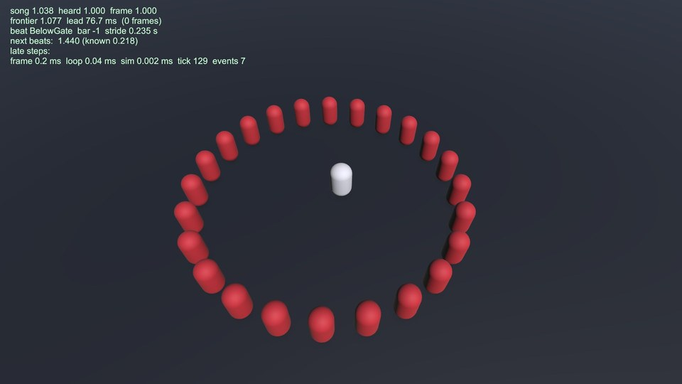
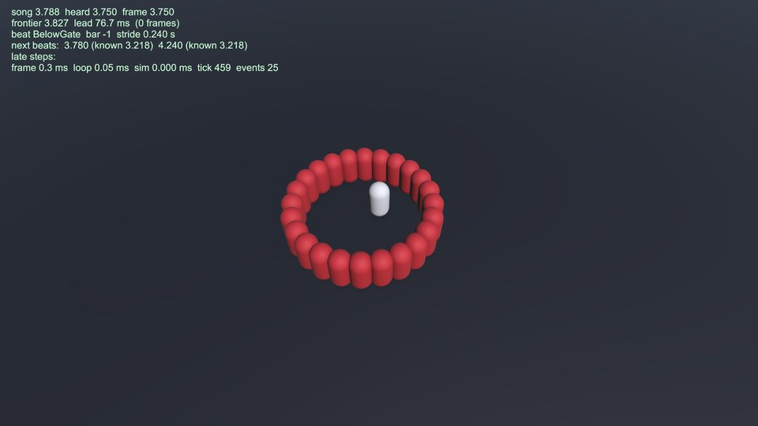
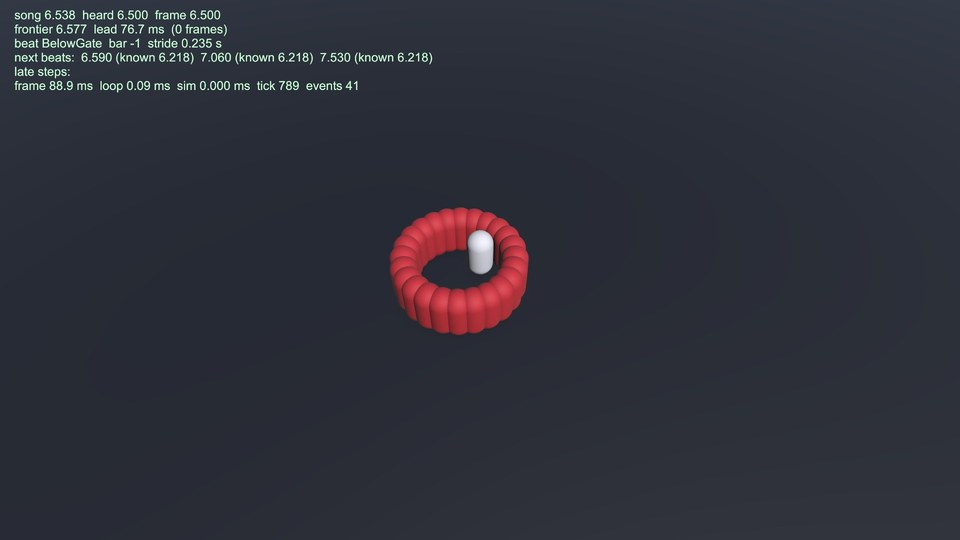

# The client's frame loop (ps-msz.3.5)

The main thread's loop around the sim ([the design](../../../docs/design/unity-game.md),
Architecture, Clocks, The Sim Lead, Key Presses and Late Steps, Debug Surfaces): the plugin's
entries and the Input System's keys into the sim, the sim stepped to the frontier, its state kept
in a short history and its events handed to presenters, each frame shown at frameSong. The code is
game/Assets/Game/Client/Loop/; until the presenters land it draws placeholder capsules on a plane.

## Flags

Boot runs the loop unless `--spike` or `--spike-out` asks for the sync spike.

| Flag | What |
|---|---|
| `--file <audio or .m3u>` | the music through the plugin; live, song time is the music's and the run ends with it |
| `--fixed-time` | song time is the frame's, n/60 at frame n; with `--file`, each frame waits until the plugin's analysis covers its frontier and entries are known exactly at stamp + B; the output is silent |
| `--seed N` | the sim's seed |
| `--events FILE` | a scripted event feed beside the sim's: JSON lines of `{"kind", "t", "i": [...], "d": [...]}` in SimEvent's slots ([ring-128.jsonl](ring-128.jsonl) is one) |
| `--overlay` | starts with the debug overlay shown; F3 toggles it |
| `--headless` | silent output, 60 frames per second. Unity's player also takes it as -nographics, so stills run under `--fixed-time` without it |
| `--loop-out FILE` | each frame's frameSong, frontier, lead, tick, the sim's hash and event count, and the hero's position, as CSV |
| `--seconds N` | quits after N seconds (Boot) |

In the game the arrows or WASD stride and Space stomps; keys reach the sim with their event
timestamps mapped by keySong.

## How it was run

On the Mac (jarvis, built-in speakers, 48 kHz, Unity's 256 x 4 DSP buffer), IL2CPP, from the
worktree's root:

```sh
EXE="game/Builds/mac/il2cpp/PlaylistSurvivors.app/Contents/MacOS/Playlist Survivors"
C="$PWD/captures/game/loop"
"$EXE" -batchmode -logFile $C/live.log --file public/reactive/house-128/house-128.ogg --headless --seconds 120 --loop-out $C/live.csv
"$EXE" -batchmode -logFile $C/fixed-1.log --fixed-time --file public/reactive/house-128/house-128.ogg --headless --seconds 30 --loop-out $C/fixed-1.csv
"$EXE" -batchmode -logFile $C/fixed-2.log --fixed-time --file public/reactive/house-128/house-128.ogg --headless --seconds 30 --loop-out $C/fixed-2.csv
cmp $C/fixed-1.csv $C/fixed-2.csv
uv run --project demo3d/tools game look loop --at 1,3.75,6.5 --player-args "--file $PWD/public/reactive/house-128/house-128.ogg --events $PWD/game/evidence/loop/ring-128.jsonl --overlay"
```

The logs and CSVs stay in the gitignored captures/game/loop/; the stills were moved here from
look/loop/.

## Results

- **Live, the lead is the output latency plus the margin.** The headless File run played
  house-128 to its end (3749 frames, 62.5 s): lead median 76.6 ms, p5 to p95 76.6 to 76.6, min to
  max 76.6 to 78.0, against an output latency of 38.0 ms (the device's 16.6 plus 4 x 256 frames)
  and a margin of 38.7 (two 60 Hz frames plus one 5.3 ms buffer). frameSong never ran backwards
  and was never held, no frame showed the frontier's state, all 4020 entries reached the sim, and
  a sim step took 3 µs at the median (0.43 ms at most). The lead is the margin plus the output
  latency by construction; the run shows it stays there (the frame term never widened).
- **The margin grew to keep every settled event schedulable** (the Warden, ps-msz.3.17). The
  sound hook first refused sounds within Unity's whole DSP buffering (4 buffers) of the DSP
  clock, more than the margin left, so about 40% of the events a frame settled (all of them at
  512-frame buffers or 120 fps) could not be scheduled. The spike's `--click-lead` runs showed a
  sound needs only one buffer past the DSP clock's reading
  ([spike, Scheduling headroom](../spike/README.md#scheduling-headroom)); the margin now also
  covers the reading's buffer-sized step and the sim's tick, `2 frames + 1 tick + 2 buffers`
  (LoopTests' EveryEventAFrameSettlesCanStillBeScheduled checks it at 60 and 120 fps and 256 to
  1024 frames). Re-run on a Mono player (30 s live, two 15 s fixed-time runs): lead median
  90.3 ms, p5 to p95 90.3 to 90.4, max 91.6 (output latency 38.0 + margin 52.3); the fixed-time
  CSVs were again byte-identical.
- **Fixed time is frame-exact.** The two 30 s runs wrote byte-identical CSVs: 1801 frames, each at
  song time n/60, with the same frontier and the same sim hash at every frame (0 entries known
  late, event hash 6D36261061AFC33C). The frames waited for the plugin's analysis whenever they
  ran ahead of it, so when the plugin's thread delivered entries never mattered.
- **The overlay and the placeholder view draw in windowless stills.** The stills show 24 scripted
  enemies (red) stepping in on each 128 BPM beat around the hero (white), with the overlay:
  song, heard and frame time, frontier and lead, the next beats with their known_at, late steps,
  and the frame's and sim's timings.

| t = 1.0 | t = 3.75 | t = 6.5 |
|---|---|---|
|  |  |  |

EditMode tests (game/Assets/Game/Tests/EditMode/LoopTests.cs) cover the clock mapping (frontier,
lead, keySong, the sound-scheduling hook), the DSP fit under frame jitter and its 2 s window, the
frame clock, the state history's interpolation, event dispatch and the scripted feed, a frame
allocating nothing, keys injected through the Input System reaching the sim at their heard
times, and a fixed-time house-128 run giving the same hash at every frame however its entries
arrive.
