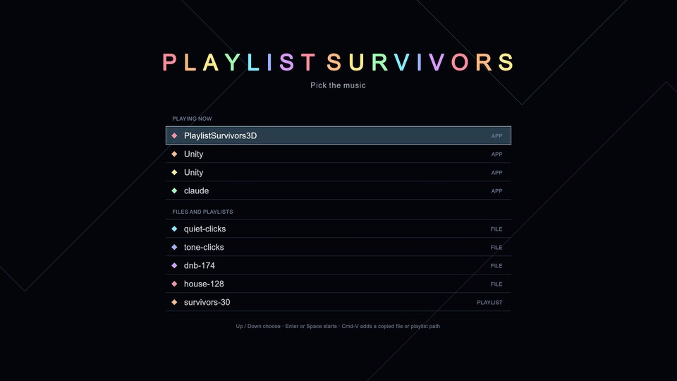

# The title screen, live runs and --app (ps-msz.5.3)

The client's side of Delayed listening on the Mac: the title screen's source picker, `--app`,
an output device change ending the run, and the player's permission to tap an app
(docs/design/unity-game.md, "Platform capture and crash safety", Shipped (ps-msz.5.3)).
2026-10-31, jarvis (MacBook speakers at 48 kHz), the IL2CPP player. No System Audio Recording
grant is held by an agent's terminal, so every tap here captured silence; hearing it is the
operator's rows in [operator-pending.md](../operator-pending.md).

```sh
EXE="game/Builds/mac/il2cpp/PlaylistSurvivors.app/Contents/MacOS/Playlist Survivors"
C=$PWD/captures/game/title
```

## The title screen



```sh
uv run --project demo3d/tools game look title --evidence title --at 1.5 \
  --player-args "--title --music-dir /abs/dir/with/three/files"
```

A batch-mode player draws the panel into a target of its own, which the stills keep in place of
the camera's view. PLAYING NOW lists what `ps_list_apps` reported at that moment: another
worktree's 3D demo, two Unity editors and the agent's own app (a quiet `afplay` started from its
shell is listed under it). The files are two recent picks and the folder's three.

## The player's signature and usage description

```sh
uv run --project demo3d/tools game build --backend il2cpp
plutil -extract NSAudioCaptureUsageDescription raw PlaylistSurvivors.app/Contents/Info.plist
codesign --verify --deep --strict --verbose=1 PlaylistSurvivors.app
codesign -dr - PlaylistSurvivors.app
```

- Usage description: "Playlist Survivors plays the music you pick 3 s late, so it knows every
  beat before you hear it." Bundle ID `ca.thurn.playlist-survivors.game`.
- `valid on disk`, `satisfies its Designated Requirement`, nested code included (the plugin,
  Burst's bundle, GameAssembly and UnityPlayer).
- `designated => identifier "ca.thurn.playlist-survivors.game" and certificate leaf =
  H"6d574aac493685394669e6b406e3e4e92c4a55fd"`: native's stable "Playlist Survivors Dev"
  identity, so the grant survives rebuilds. A Mac without it gets an ad hoc signature.

## Headless runs

| Run | Command | Result |
|---|---|---|
| File, unchanged | `"$EXE" -batchmode -logFile $C/file.log --file public/reactive/house-128/house-128.ogg --headless --seconds 10` | 578 frames, 1057 entries (0 late), lead 90.3 ms, quit at 10 s |
| `--app` by pid | `afplay -v 0.003 house-128.wav &` then `"$EXE" -batchmode -logFile $C/app.log --app <its pid> --headless --seconds 9` | tapped at once: state playing, muted 1, stalls 0, releases 0; 347 entries |
| `--app` missing | `"$EXE" -batchmode --app "no such app" --headless --seconds 9` | exit 1 after 3 s: `no app named "no such app" is producing audio; playing now: none` |
| Title to run to title, headless | `"$EXE" -batchmode --title --music-dir <dir with an 8 s wav> --title-pick tone --headless --seconds 20` | picked, played to the file's end, `back to the title screen, the music ended`, the title screen again until 20 s |
| The same with graphics | as above without `--headless`, a near-silent wav | the arena, hero, crowd and effects loaded, unloaded by the boot scene's reload with no error, the title screen again |

`afplay` stops after about 2 s on an Ogg file here, so the `--app` run plays a WAV made with
`afconvert -f WAVE -d LEI16`.

Not checked windowless: the keys, clicks and Cmd-V (no window to type into), an output device
change (switching devices needs the operator), and the delayed music heard. Those are the
operator's rows.
