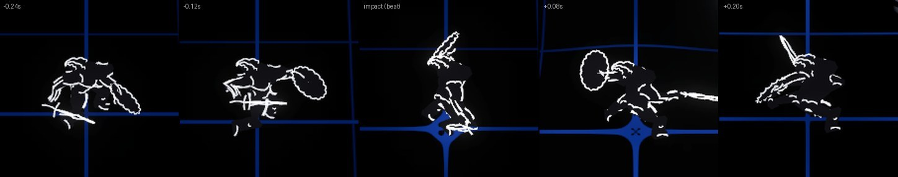
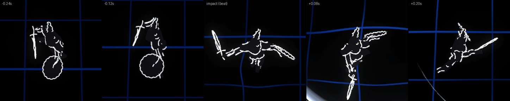
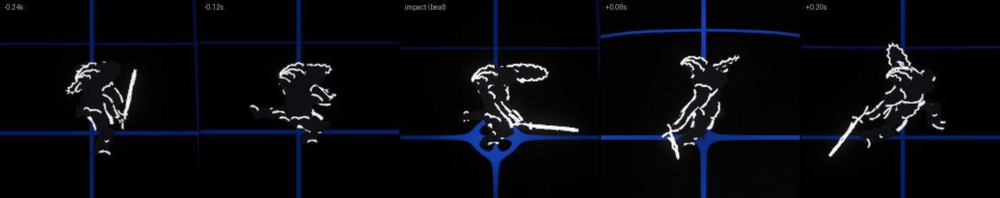
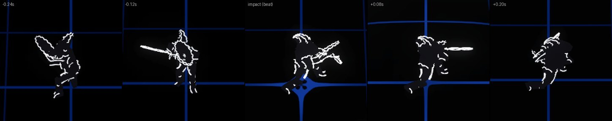
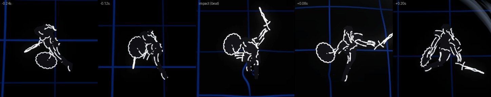
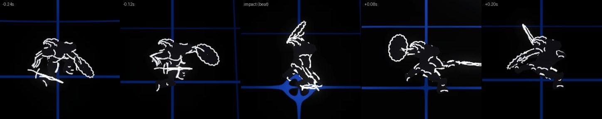
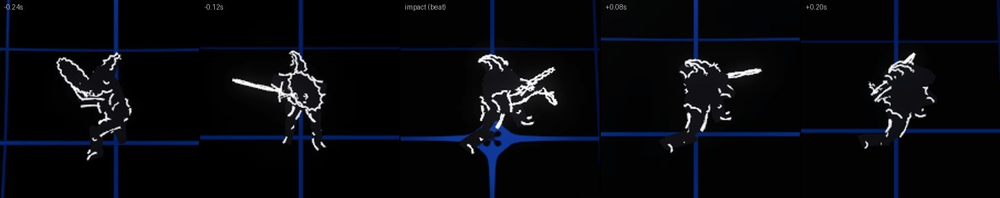
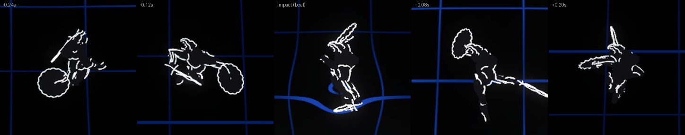
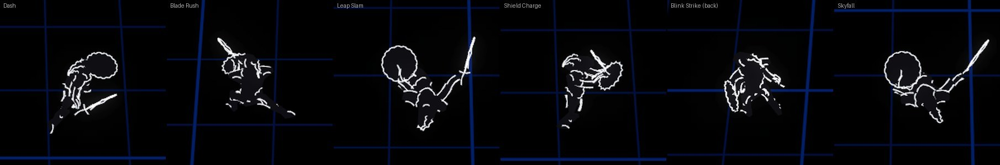
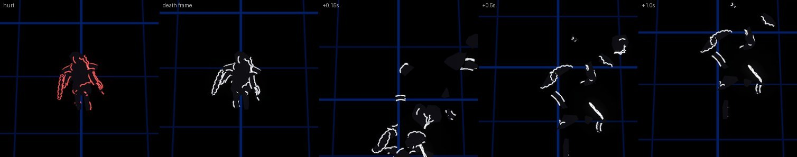

# The hero (ps-6y2.20)

The knight's white edge cut, posed on the CPU from its rig, under the game's camera, grid and post (design.md, The Hero;
Attacks > Rules; Dashes). Every still here comes from one headless fixed-time run of the scripted `hero` scene
([HeroScene.cs](../../Assets/Champions/Client/Scenes/HeroScene.cs)); the strips are crops round the hero (found by its
code in the stills' type-ID pass), scaled up. The cut's own review sheet is in [edgecuts/hero](../edgecuts/hero/README.md):
64.0% black at game scale (55% needed), 84 line segments, 348 triangles.

Reproduce:

```sh
just champions-tool editor stop                     # a fresh warm editor: one that ran the EditMode tests measures a different bloom
just champions-tool edgecut review hero             # the cut, its rig and its sheets
just champions-build
just champions-tool stills --scene hero             # captures/stills: every still, hero-swings.json
```

## Sword Slash at 80, 128 and 174 BPM

For each tempo the real sim plays a scripted song from 0 with three tough dummies east of the hero; the scene hands its
events to the hero presenter as the assembly's dispatch will (moves, swings), to the world (the beat rings) and to the
weapon effects (each strike's slash). The hero stands for 4.5 s, then runs round the dummies, so the legs run under an
upper body twisted to the aim. Sword Slash is rank 1 at 80 BPM and rank 3 (every fourth swing a spin) at 128 and 174.
The sim plans each swing 0.35 s before its impact (`attacks.json swordSlash.windupS`, now LightCombo01A's impact frame;
it was a provisional 0.25 s); the presenter plays its clip so the impact frame lands on the impact, at natural speed
when it can, up to 1.15x when it must, else entering part-way at natural speed.

| BPM | Rank | Period | Swings | Cadence locked | Fastest clip | Worst impact off its beat (after the lock) |
| --- | --- | --- | --- | --- | --- | --- |
| 80 | 1 | every beat, 0.750 s | 13 | 1.500 s | 1.00x | 0.000 ms |
| 128 | 3 | every 2 beats, 0.938 s | 10 | 1.406 s | 1.00x | 0.000 ms |
| 174 | 3 | every 2 beats, 0.690 s | 14 | 1.034 s | 1.00x | 0.000 ms |

Every clip played at natural speed (1.00x; the limit is 1.15x) and every impact after the cadence locked to the beat
landed on its beat. Each tempo's first swing strikes on the beatless 1 s pulse before the lock, as the design says.
Slashes alternate LightCombo01A and LightCombo01B (A starts from the sword idle, B where A ends; after a pause, A again);
spins play HeavyFlourish01, whose 1.4 s flourish is longer than the swing's notice, so it enters about 1 s in and still
turns about 300 degrees into its impact. The second 80 BPM swing enters 0.167 s in: the cadence locked half a second
after the pulse's swing, which had not finished its follow-through. The full record, with each clip's start and
follow-through, is [hero-swings.json](hero-swings.json); the run's log says the same (`Hero: swing ...`).

Each strip: 0.24 and 0.12 s before the impact, the impact frame (the beat ring leaving the feet bends the grid there),
and 0.08 and 0.2 s after.

- 80 BPM, standing (LightCombo01A): 
- 80 BPM, running round the dummies (LightCombo01A, the torso twisted to them): 
- 128 BPM, standing (LightCombo01B): 
- 128 BPM, the spin (HeavyFlourish01): 
- 128 BPM, running (LightCombo01B): 
- 174 BPM, standing (LightCombo01A): 
- 174 BPM, the spin: 
- 174 BPM, running (LightCombo01A): 

<details><summary>Every swing</summary>

| BPM | Swing | Clip | Impact (s) | Beat (s) | Speed | Legs | |
| --- | --- | --- | --- | --- | --- | --- | --- |
| 80 | 0 | LightCombo01A | 1.0000 | 0.7500 | 1.00x | stand | beatless pulse (before the lock) |
| 80 | 1 | LightCombo01B | 1.5000 | 1.5000 | 1.00x | stand | entered 0.167 s in |
| 80 | 2 | LightCombo01A | 2.2500 | 2.2500 | 1.00x | stand |  |
| 80 | 3 | LightCombo01B | 3.0000 | 3.0000 | 1.00x | stand |  |
| 80 | 4 | LightCombo01A | 3.7500 | 3.7500 | 1.00x | stand |  |
| 80 | 5 | LightCombo01B | 4.5000 | 4.5000 | 1.00x | stand |  |
| 80 | 6 | LightCombo01A | 5.2500 | 5.2500 | 1.00x | run |  |
| 80 | 7 | LightCombo01B | 6.0000 | 6.0000 | 1.00x | run |  |
| 80 | 8 | LightCombo01A | 6.7500 | 6.7500 | 1.00x | run |  |
| 80 | 9 | LightCombo01B | 7.5000 | 7.5000 | 1.00x | run |  |
| 80 | 10 | LightCombo01A | 8.2500 | 8.2500 | 1.00x | run |  |
| 80 | 11 | LightCombo01B | 9.0000 | 9.0000 | 1.00x | run |  |
| 80 | 12 | LightCombo01A | 9.7500 | 9.7500 | 1.00x | run |  |
| 128 | 0 | LightCombo01A | 1.0000 | 0.9375 | 1.00x | stand | beatless pulse (before the lock) |
| 128 | 1 | LightCombo01A | 2.3438 | 2.3438 | 1.00x | stand |  |
| 128 | 2 | LightCombo01B | 3.2813 | 3.2813 | 1.00x | stand |  |
| 128 | 3 | HeavyFlourish | 4.2188 | 4.2188 | 1.00x | stand | entered 0.998 s in |
| 128 | 4 | LightCombo01A | 5.1563 | 5.1563 | 1.00x | run |  |
| 128 | 5 | LightCombo01B | 6.0938 | 6.0938 | 1.00x | run |  |
| 128 | 6 | LightCombo01A | 7.0313 | 7.0313 | 1.00x | run |  |
| 128 | 7 | HeavyFlourish | 7.9688 | 7.9688 | 1.00x | run | entered 0.998 s in |
| 128 | 8 | LightCombo01A | 8.9063 | 8.9063 | 1.00x | run |  |
| 128 | 9 | LightCombo01B | 9.8438 | 9.8438 | 1.00x | run |  |
| 174 | 0 | LightCombo01A | 1.0000 | 1.0345 | 1.00x | stand | beatless pulse (before the lock) |
| 174 | 1 | LightCombo01B | 1.7241 | 1.7241 | 1.00x | stand |  |
| 174 | 2 | LightCombo01A | 2.4138 | 2.4138 | 1.00x | stand |  |
| 174 | 3 | HeavyFlourish | 3.1034 | 3.1034 | 1.00x | stand | entered 1.110 s in |
| 174 | 4 | LightCombo01A | 3.7931 | 3.7931 | 1.00x | stand |  |
| 174 | 5 | LightCombo01B | 4.4828 | 4.4828 | 1.00x | stand |  |
| 174 | 6 | LightCombo01A | 5.1724 | 5.1724 | 1.00x | run |  |
| 174 | 7 | HeavyFlourish | 5.8621 | 5.8621 | 1.00x | run | entered 1.110 s in |
| 174 | 8 | LightCombo01A | 6.5517 | 6.5517 | 1.00x | run |  |
| 174 | 9 | LightCombo01B | 7.2414 | 7.2414 | 1.00x | run |  |
| 174 | 10 | LightCombo01A | 7.9310 | 7.9310 | 1.00x | run |  |
| 174 | 11 | HeavyFlourish | 8.6207 | 8.6207 | 1.00x | run | entered 1.110 s in |
| 174 | 12 | LightCombo01A | 9.3103 | 9.3103 | 1.00x | run |  |
| 174 | 13 | LightCombo01B | 10.0000 | 10.0000 | 1.00x | run |  |

</details>

## The dash poses

Scripted (the client cannot equip a dash in the sim), each with dashes.json's distance and duration, a still halfway
through: the plain Dash's long low stride (the forward dodge's lowest frame, held), Blade Rush's HeavyStab01 thrust,
Leap Slam's LightLeaping01 at the top of its arc (its landing on the dash's end), Shield Charge's forward parry held
(the shield up front), Blink Strike back at its end with a flare, and Skyfall's higher leap.



## Hurt and death

Running, a hit flashes the hero once in the palette's hurt red; on the killing frame it breaks into white shards thrown
away from the blow, which sink as a monster's do.



## How it is drawn

- **The cut** ([hero.py](../../tools/recipes/edgecut/hero.py)): hulls per part over the knight, long creases, arm
  contours, the shield an empty circle over a dark disc, the blade's two edges and a core stroke drawn twice (the lines
  add, so the core is the brightest line on screen). The review draws it in the palette's hero white.
- **The rig**: a hero bake also keeps every clip as its bones' local poses at 60 Hz (`EdgeRig`), so the client can
  layer them: the run's legs (sprint, backpedal and strafes, blended by the travel's angle to the legs, cycling once a
  stride), the sword idle's arms over them, then each swing and the dash's pose; a swing laid over walking legs keeps
  its spine's turn in model space, and the spine then turns to the aim. The bake checks its composed poses against the
  bone texture's matrices.
- **The figure**: `EdgeFigure` draws it with the crowd's EdgeBody and EdgeLines shaders from a palette uploaded each
  frame; that palette seeds the shatter on the hero's death.
