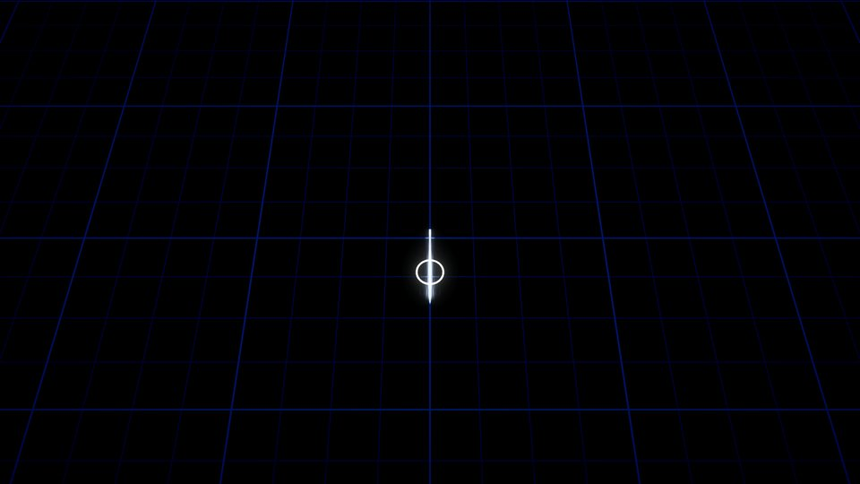
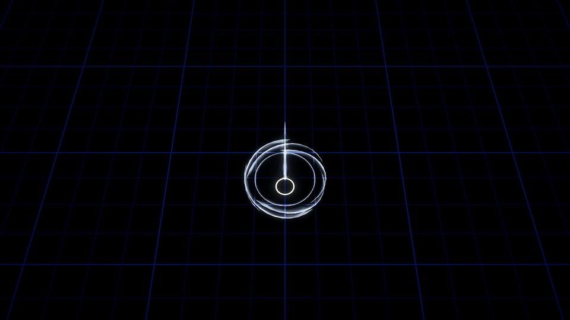
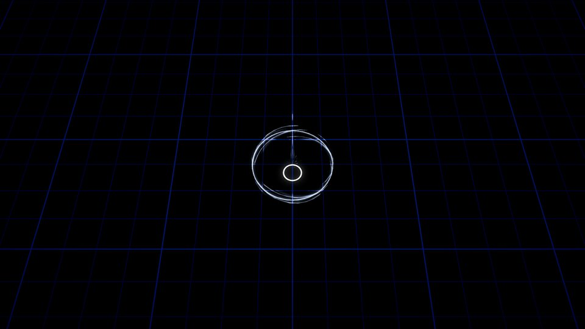
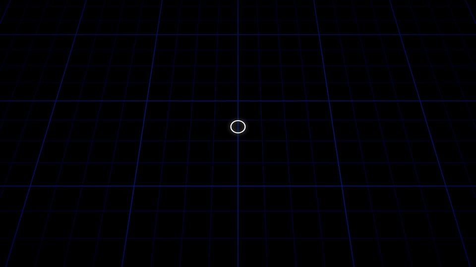

# Movement dash and destination support (ps-3wc.4)

The live dash uses the plain 4 m / 0.15 s movement form, 0.6 s cooldown,
0.15 s buffer and 0.1 s extra invulnerability. Heard-time judgement and input
re-walking are unchanged. With reliable music, timing changes only the
weapon reward; without reliable music every dash earns it. Old damaging
forms, dash-specific cooldown/damage mods and dash upgrade cards are disabled
in live runs. Their schemas and regression fixtures remain behind the internal
`DashRules.LegacyForms` opt-in, which live content cannot enable.

At a timed start, `WeaponBuild.Empower()` refreshes each equipped weapon's
nonstacking flag. `BeginActivation` consumes only that weapon's flag when it
has a target, returning 1.5 coverage area for the activation's children.
Acquisitions start unempowered; level/form changes preserve unspent flags.
The cadence implementation and weapon families consume this shared contract
for strikes and persistent pulses/volleys. Circular coverage uses square-root
radius scaling; empowerment adds no direct damage.

Landing Blast occupies one support slot and deals one circular hit at the
actual movement endpoint, including a stop/slide against a structure. Its
initial radius is 2 m, damage is `1 + LandingBlast family bonus`, multiplied
by compatible damage bonuses; compatible area bonuses scale its coverage.
Tempo, projectile and echo supports do not apply. It consumes no weapon flag,
does not strike during travel, and cannot echo, repeat or trigger kill chains.
Its own level does not alter movement or invulnerability.

## Render evidence

These are real Unity Mono-player captures from the `movement-dash` scripted
scene, driven by live Simulation events. A white marker stands in for the
hero. First dash: empty ground without Landing Blast. Second dash: support
acquired immediately before it. All dashes are beatless and therefore timed.
No weapon damage activation is fabricated for the scene.

| Empty ground at 1.05 s | Landing at 2.18 s |
| --- | --- |
|  |  |
| Settling at 2.25 s | Rest at 2.6 s |
|  |  |

Visual assessment: the dash's narrow white smear stays at the hero, and the
blast reads as intersecting spectral rings around the landing pocket. The
surrounding grid remains dark; by the final frame only the hero marker is
left. The blast is more ornate than the movement reward and is spatially
contained. Routine dash rings no longer trigger the global special-moment
flash, grid bend or camera response. Empowered weapon activations receive a
local ring/spark cue and a small accent through the existing presentation
path; dash whoosh and timing accent remain scheduled immediately in heard time.

Limitations: this sparse scene proves event placement and local rendering,
not horde readability, natural hero animation, full-build motion or speaker
balance. Those assembly/operator checks are recorded in operator-pending.
The diagnostic metrics are retained for reproducibility, not visual acceptance;
background-light ratios are high in empty frames containing almost only grid.

Reproduce from this revision:

```sh
just champions-build --backend mono
just champions-tool stills --backend mono --scene movement-dash --out /tmp/movement-dash
just champions-tool look /tmp/movement-dash --out rhythm_champions/evidence/movement-dash
dotnet test rhythm_champions/dotnet/Champions.Sim.Tests
just champions-tool test
```

Deterministic live tests cover on/off-beat motion and invulnerability equality,
original heard-time buffering, empty-ground/beatless reward, independent flags,
skips, acquisitions/forms, persistent pulse consumption, optional blast,
blocked endpoint, additive damage/area scaling and non-repetition. Archived
dash fixtures still cover the original input/replay machinery. The world
presentation test ensures routine reward rings cannot trigger global moments.

Validation on this worktree: 279 sim tests, 112 Unity EditMode tests, Mono
player build and all four movement-dash captures passed. The existing
structure showcase was migrated from Blade Rush to Landing Blast and also
captured its actual structure-break frame at scene time 6.133 s.
