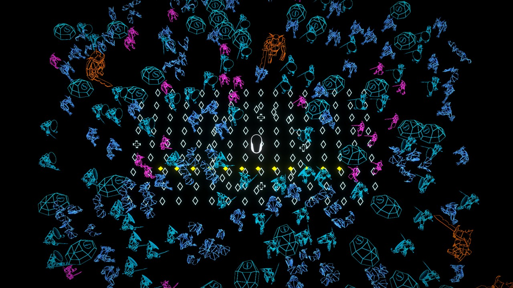
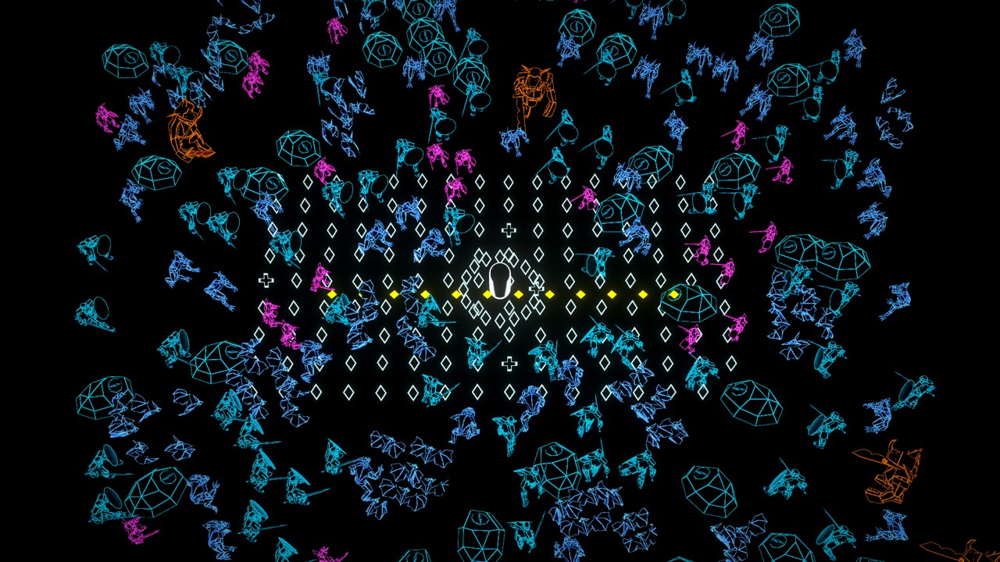

# Persistent pickups — ps-3wc.5

Built and captured on jarvis, 2026-11-02, Mono Unity player:

```
just champions-build
just champions-tool stills --scene pickups --out /tmp/ps-3wc5-stills
```




These are actual player renders with the palette scene's moving crowd,
a stand-in hero, 160 authored pickup representations and 12 enemy spores.
The arrangement is intentionally regular for comparison. Attraction motion
in this art preview is scripted; simulation tests exercise real collection.
White-blue hollow diamonds denote XP; hollow crosses denote healing. Yellow
filled beads remain enemy shots. The hero's larger white silhouette remains
clear, while some pickups partially overlap cyan crowd outlines.

A blind visual critic inspected the initial two full-resolution captures:
pickups and shots were readily distinguishable by fill and color, crosses
were clear, and the hero remained easy to locate. It flagged a dense zigzag
band from the initial scripted convergence. The preview now uses short radial
paths and removes arrivals; the revised frame was inspected directly. The
regular grid remains a test arrangement, not a proposed death pattern.

Validation: 280 simulation tests pass, including death-position XP, no instant
kill XP, merged-value conservation, real structure streaming/revisits,
one-time collection, boss-arrival persistence, healing cadence/clamping,
Attraction, Vitality, Armor, Regeneration, Stride and deterministic hashes.
Level-up picks do not heal. Existing recorded-session checks pass unchanged.

Accumulated-drop probe: 100,000 separate stored cells retain 50,000 XP;
120 pickup ticks perform exactly 11,760 cell probes at default attraction,
independent of distant storage. The measured tick loop was below 1 ms in this
run (diagnostic only; no machine-speed assertion). A ten-entry preview stays
bounded and retains all value. Runtime visual capacity is 384 meshes per
frame, with up to 256 traveling drops; inactive cells are never erased for
rendering. Sparse storage grows with occupied explored cells, not kill count
inside a cell. No vendor models or reusable derived assets are in this evidence.

The headless capture does not establish low-end windowed GPU cost, full-build
boss-threat readability or hand-play pickup balance. Those checks remain in
operator-pending.md; no numeric look metric accepts this art.
