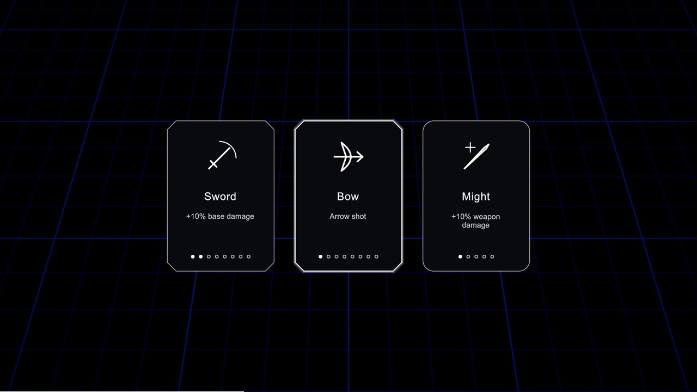
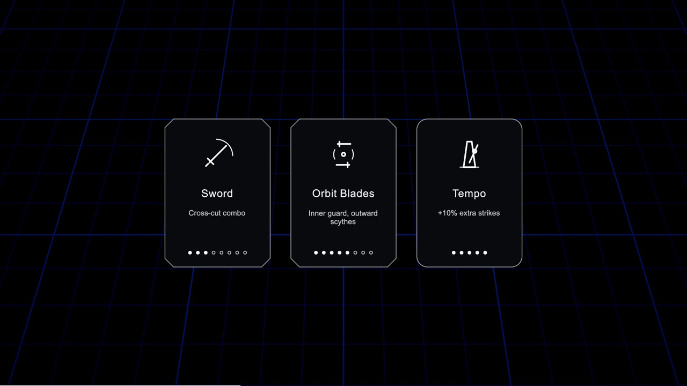

# Immediate build choices — ps-3wc.6

Current runs start playing with Sword level 1 and no opening menu. Collected
XP opens cards at the end of its collection tick, during bosses too. Each
normal offer includes an owned upgrade when eligible, then draws distinct
cards from all remaining legal weapons/supports. Six slots of each kind,
weapon level 8 and individual support caps are enforced by WeaponBuild.
New supports must benefit the current build. One or two legal cards appear
when that is all that remains; zero legal cards grant +5 max health directly,
without healing. Multiple earned levels drain in sequence under one hold.

BossDeath.Treasure still queues the encounter reward; Progression.Treasure
also remains the encounter hook. Rewards are owned-only +1 levels, including
normal form boundaries, and resolve ahead of queued normal levels. The boss
kill owns the full heal separately. Progression adds no boss scheduling.

Card/pause holds preserve cooldowns, i-frames, enemy moves and spores. On
resume each telegraph keeps at least its remaining seconds, rounding its
landing forward onto the future grid when reliable. New weapon geometry can
subscribe to Simulation.Resumed(elapsed) to shift outstanding deadlines;
shared Echo work and persistent lifetimes already do this. Space held across
cards must be released before it can dash again. Threat/spore presenters
freeze their clocks and restore the surviving marks on resume.

## XP sample, not a claim of hand-play balance

The curve starts at 20 collected XP and grows 9% each level. The deterministic
sample collects 0.8 XP/s for the opening 30 seconds, then linearly rises to
6 XP/s by 15 minutes. Routing/output multipliers change collected value;
these are explicitly supplied collection samples, not automatic time awards.
No boss-summon XP is assumed. Boss rewards are additional to these counts.

| Collection multiplier | First choice | Normal choices at 15 minutes |
| --- | --- | --- |
| 0.85 | 30 s | 29 |
| 1.00 | 25 s | 30 |
| 1.15 | 22 s | 32 |

Run `dotnet test rhythm_champions/dotnet --filter SurvivorProgressionTests
--logger 'console;verbosity=normal'` to reproduce the reported pace.
Actual kill rates, collection routes and finite boss-summon budgets still
need full-run tuning after the weapon families and encounters are integrated.

## Verification

317 simulation tests pass, including deterministic legal offers, full slots,
caps, compatibility, exhausted pools, multiple levels, owned boss rewards,
no level-up healing, a live boss pattern held through XP cards, stationary
spores through holds, cooldowns/i-frames and held Space release. 112 Unity
edit-mode tests pass. The Unity player builds successfully. The duel fixture
was re-recorded for the intentional earlier XP threshold; the walk fixture
remains unchanged. Archived offers are explicitly opt-in under
DashRules.LegacyForms so historical combat fixtures remain useful.

## Card layout inspection

Captured from the Unity player with `champions stills --scene ui`, 2026-11-02.
These are scripted card examples over the existing grid, not evidence of a
full-build fight. Direct visual inspection found readable names, short text,
distinct weapon/support frames and clear 8/5-level pips, with no clipping.
The first pass reused a sword-volley icon for Bow and the area icon for all
supports; the final pass gives Bow authored bow/arrow line art and chooses
existing icons by each support's meaning. Some descriptions wrap to two
short lines; full-run threat readability still needs the pending hand-play.
