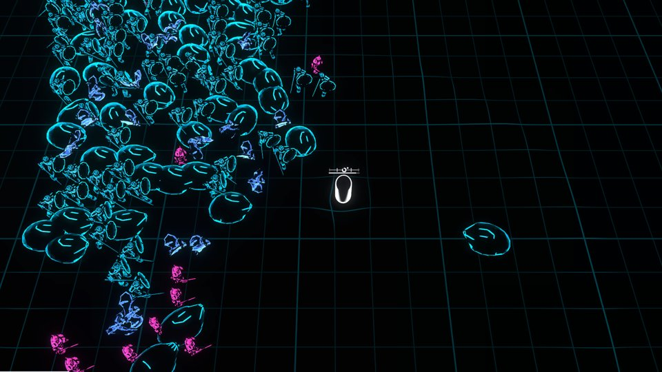
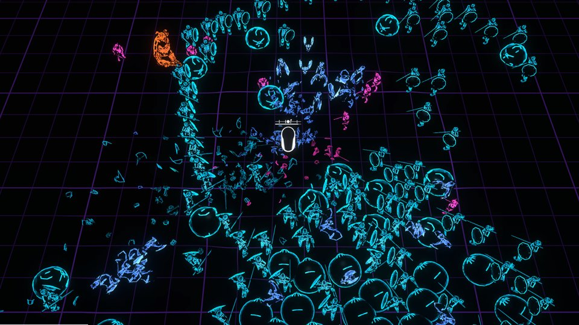
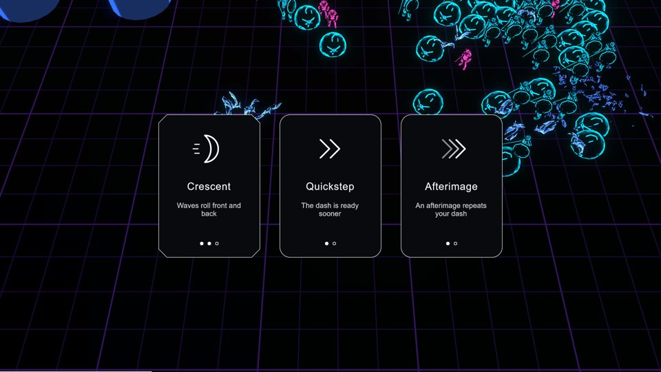

# ps-6y2.21: level 1 end to end

Level 1 assembled (RC18): the run from the first offer to the end card, every
sim event wired to its presenter through one `EventDispatch`, scripted
inputs, the first tuning, sessions replayed in the player, and the level's
stills in CI. The horde draws in the trailer's edge look through ps-6y2.28's
crowd (`Client/Crowd/TrailerCrowd.cs` behind the crowd presenter's
`ICrowdView`; `StandInCrowd` when no monster is baked); the hero, the bosses
and the structures draw as stand-ins until ps-6y2.29-30 land.

## What plays

- `just champions --file <song or .m3u>` (or `--app`, or the title's picker)
  starts level 1: the first offer over the empty, held world; play from the
  next downbeat; the level's horde, structures, the Fat Ogre (called at 7:00
  of run clock) and the dragon (13:00, once the Ogre is dead); the end card
  1.5 s after a death, lit after the dragon; Again starts a new run on the
  same music, which plays on. Esc or a lost focus pauses (never a scripted
  run).
- `Client/Loop/RunPresentation.cs` wires, in drawing order: the world (beat
  wave, zones, rings), the structures, the crowd (`Client/Crowd/`: the crowd
  presenter over `ICrowdView`: `TrailerCrowd`, each mob its vendor mesh in
  the trailer's look, walking by the ground it covers, springing from its
  beat steps and kicks, an elite lunging into its landing, shattering on its
  kill's frame; `StandInCrowd` without baked monsters), the boss, the
  telegraphs (red and yellow), the spores (yellow beads), the hero's
  commands, the weapon effects (`Client/Hero/EffectCues.cs`, ps-6y2.16's
  mapping), the run's UI and the sounds. A presenter that throws is
  contained and counted (`Run:` and `Replay:` lines name the faults).
- The timeline stays where ps-6y2.7 and ps-6y2.17 put it: the cast joins by
  `level1.json`'s `mix` (`fromS`: bats 1:30, goblins 3:00, big orks 4:00,
  demons 4:30, trolls 5:30), its `bosses` call each boss (the call stops
  spawning; the arrival waits for a strong downbeat), and the Ogre's death
  resumes spawning with `secondHalfMix` (mushrooms join).

## Scripted inputs

`Sim/Session/ScriptedPlayer.cs`, shared by the player's `--walk`/`--picks`
and the sim's tests: `idle` never moves; `reference` kites a ring round the
start away from the monsters within 3 m, dashes on every other beat (keeping
its dash for a telegraphed landing), dodges each boss and elite landing and
each spore it sees coming, and in a duel keeps within Sword Slash's reach
and dashes through every attack on its beat; it picks by the reference
build's preferences (Lifeblood, Blade Rush, Sword Slash, Orbit Blades, Keen
Edge, Wide Arcs, then the rest). Held keys (`right@9-11`) still work.

## First tuning

Measured with `dotnet/Champions.Sim.Tests/LevelRunTests.cs` on a synthetic
playlist (210 s songs at 128 BPM, a loud drop, a quiet break and another
drop each, 4 s silent gaps), and in the player on real music.

- **An idle hero dies at 37 s** in the harness and at 40 s in the player on
  the house playlist ([idle-run.log](idle-run.log); target: within 90 s;
  `AnIdleHeroDiesWithinNinetySeconds` always runs).
- **Surges scale the ramp** (`Sim/Horde/Spawner.cs`): a loud stretch raised
  the target a share of the way to the 1,000 cap, so any loud song put 660 on
  screen in its first seconds against a design start of 150. Now it raises
  the ramp by `surge.strength` of itself (0.4: 150 to 210 at the start, 600
  to 840 by minute 12, toward the cap with the second half's density).
- **Mushrooms** weigh 0.35 in the second half (was 1): a dozen spores in
  flight at once made the second half a bullet field.
- **Lifeblood** leads the reference build's preferences: with it first the
  reference player won 2 of 8 seeds, with it fifth none.
- **The reference player** over eight seeds (`PrintTheReferenceRuns`):

| Seed | End | Ogre arrives | Ogre duel | Dragon arrives | Level | Kills | Hurt by |
| --- | --- | --- | --- | --- | --- | --- | --- |
| 31 | Death at 596 s | 424 s | 75 s | - | 7 | 6715 | touch 28, charge 1, slam 1, spore 5 |
| 32 | Death at 307 s | - | - | - | 5 | 1672 | touch 33 |
| 33 | Death at 621 s | 424 s | 98 s | - | 6 | 3360 | touch 30, spore 9, slam 1 |
| 34 | Victory at 964 s | 424 s | 86 s | 840 s | 9 | 10144 | touch 26, charge 6, spore 18, slam 1 |
| 35 | Death at 166 s | - | - | - | 4 | 930 | touch 25 |
| 36 | Death at 315 s | - | - | - | 2 | 188 | touch 20 |
| 37 | Death at 398 s | - | - | - | 7 | 5516 | touch 35, charge 3 |
| 38 | Death at 663 s | 424 s | 84 s | - | 7 | 5918 | touch 3, spore 13, charge 2 |

  It reaches and beats the Ogre in 4 of 8 and the dragon in 1 of 8 (2 of 8
  before it learned to dash on the beatless pulse: the runs are chaotic, so
  a seed's fate turns on small changes). That sits near the design's
  targets for a learning player (a first run usually reaches the Ogre; the
  dragon falls after two to four runs). Its harness deaths come mostly from
  touches in the second half's crowd; neither fodder's toughness at minute
  12 (2.75) nor the second half's density (1.0) moved its wins, and other
  reference builds (damage mods first) won fewer. Hand-play balance is the
  operator's row.
- **Spores** fire every 4 bars for 6 (the design's defaults: every 2 bars
  for 10). On real music the best runs died to spores in the second half
  (house seed 5: 11 spore hits against 7 touches; seed 4: 29 spores by
  12:30); slowed, seed 4 beat the dragon. `HordeTests` pins the new values.

## In the player

`--fixed-time --walk reference --seed N` headless, about six times faster
than real time (a 16-minute run in about 2 minutes, stand-ins drawn):

- On 24 minutes of the tree's CC songs (`public/reactive/cc-*`), 12 seeds:
  6 reach and beat the Ogre, every one dies in the second half (spores
  10 damage every 2 bars then).
- On `public/reactive/house-128` looped 20 times with 2 s gaps, 8 seeds with
  the slower spores: seed 4 wins. Its log ([victory-run.log](victory-run.log)):
  the first offer, play from 0 s, the Ogre at 7:26 of run clock dead at 8:39
  (73 s), the dragon at 13:53 dead at 16:06 (132 s), level 10, 13,581 kills,
  the lit victory card 1.5 s later, and the batch-mode quit with 0. Every
  run's end line shows no presenter faults.

`house.m3u` lists the track's absolute path 20 times with a `#PS-GAP:2` line
between each pair (none after the last):

```sh
just champions-play --headless --fixed-time --file house.m3u --walk reference --seed 4
```

## Replays: the same hash in .NET and in the player

`--replay` plays a session through the presenters with no music, as fixed-time
frames (all four sessions at 2x in about 5 s). In Mono
the duel fixture first settled another hash, for two reasons, both fixed:

- **Number parsing**: Mono's `double.Parse` is an ulp off for some 17-digit
  numbers, so a beat read from `entries.jsonl` moved. `ExactDouble`
  (`Sim/Core/Json.cs`) reads every number to the nearest double in big
  integers (Clinger's fast path for short ones), bit-identical to .NET's
  over 250,000 random strings (`SimMathTests`).
- **Trigonometry**: each runtime's math library rounds sine, cosine and arc
  tangents its own way. `SimMath` (`Sim/Core/SimMath.cs`, fdlibm's kernels)
  computes them from IEEE-exact operations only; the sim uses it throughout.
  The attacks and duel fixtures were re-recorded (same events, new hashes).

All four sessions (walk, attacks, duel and the new `fixture-level`: 75 s of
level 1 from the first offer with the reference player) settle their .NET
hashes in the player.

## CI

`scripts/ci-full`'s unity lane gained, after `player`: `replay` (every
`rhythm_champions/sessions/*/` at 2x, about 5 s), `stills` (every scripted
scene in one launch, about 19 s) and `look` (`champions look` on them as a
report that never fails the run, about 38 s). The lane ran in 106 s; ci-full
stays near 110 s of its 300 s.

## Stills

`champions stills --scene level` (in `all`): level 1 through the run's own
presenters and the reference player on a scripted song, the sim running ahead
to minute 4: the crowd at minute 4, a loud surge, and a card moment.

| Crowd at minute 4 | A loud surge | A card moment |
| --- | --- | --- |
|  |  |  |

The structure field, beat-wave phases, both duels and the effects gallery
are the `structures`, `world`, `duel-ogre`, `duel-dragon` and `gallery`
scenes, all in CI's `stills` step.
