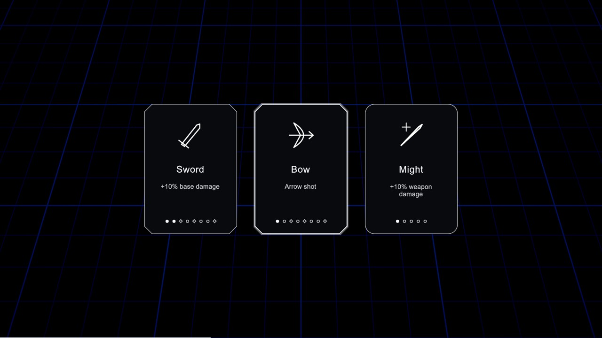
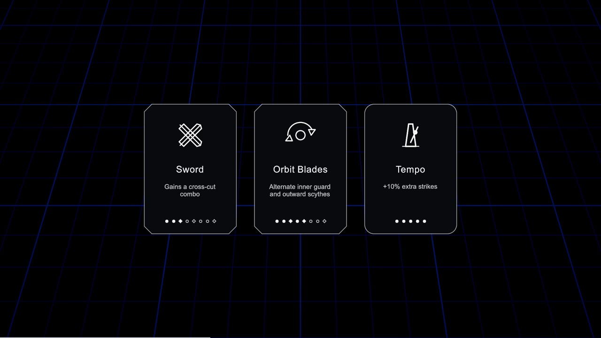
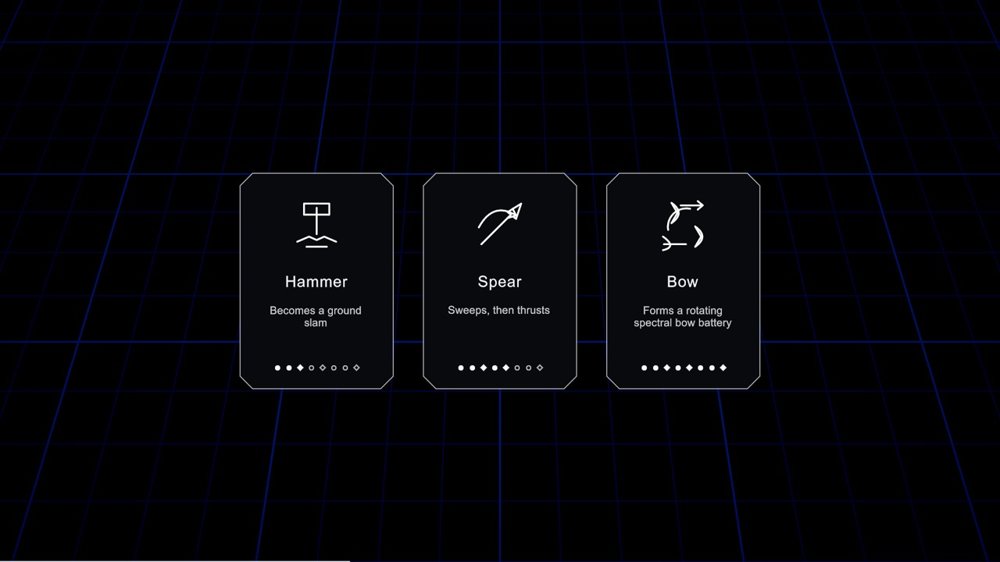
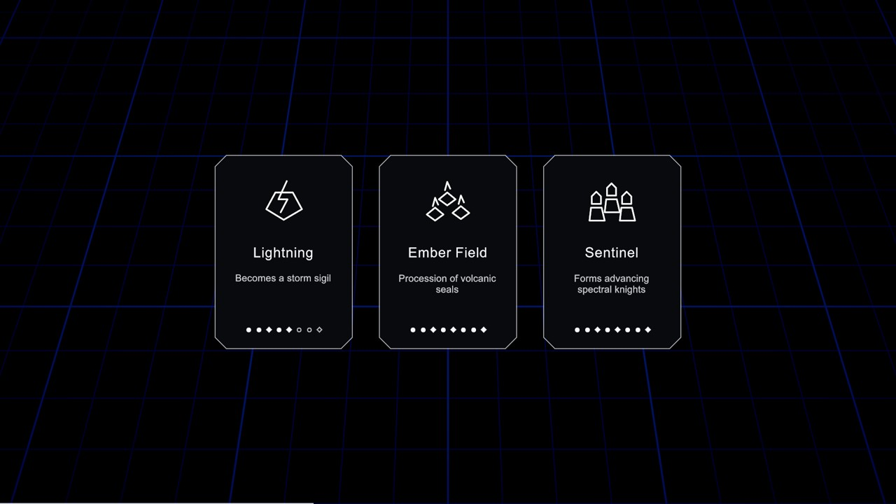
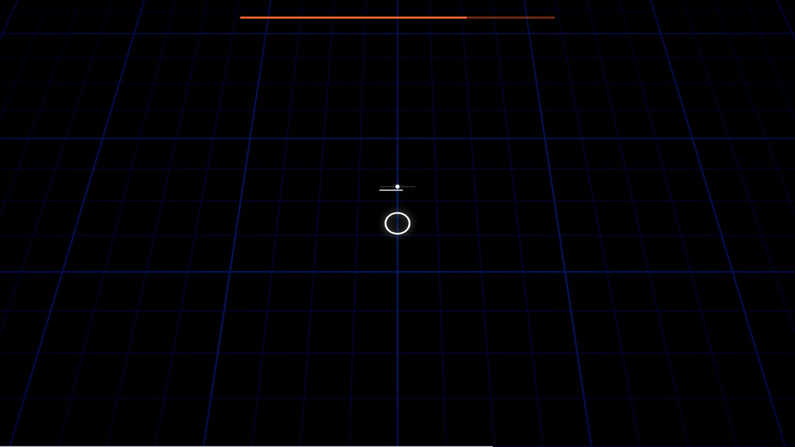
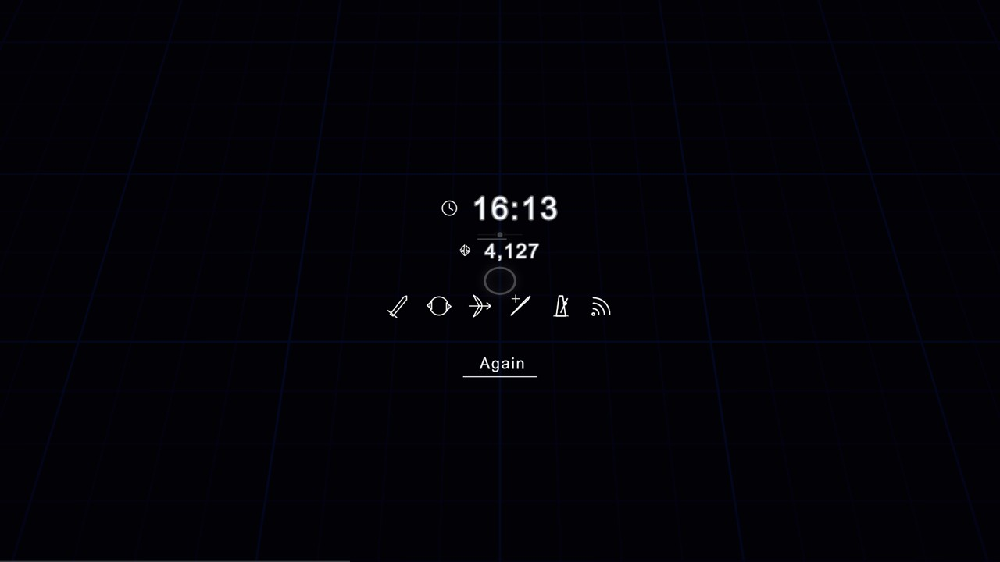

# Brief survivor choices and minimal HUD — ps-3wc.12

Runtime cards use the immediate survivor offers from ps-3wc.6: icon, name,
one brief description and small level pips. Weapon pips mark forms at 3/5/8
with diamonds; ordinary levels stay round. Support pips use each content cap,
not an assumed five. Forms and stat choices have the same footprint.

32 original SVG icons depict all eight weapons' four actions. These are
source-authored line art, with no vendor image or mesh input. `formIcons`
is optional: omitting it uses the existing provisional `icon` at every level.
The parser's former six-word limit is relaxed to twelve; current descriptions
are shorter and ordinary selection requires no inspection panel.

The only combat HUD is the hairline collected-XP bar and boss health. The
hero keeps beat ticks, dash readiness and health. Break and the held-level dot
were removed from the elements, presenter API and indicator shader. The
movement dash and empowerment's existing local effect/sound path remain.
XP collection already reaches the HUD through the snapshot; the pickup
presenter already draws persistent pickups through RunPresentation.

Results read `SimState.RunClock` into `EndSummary.CombatSeconds`: this is
actual combat, including bosses and excluding card/pause holds. ps-3wc.11's
separate `HordeClock` is never used for results. Result build icons now come
from WeaponBuild weapons/supports at their current forms, rather than the
archived Arsenal/damaging-dash loadout. Existing music picker, calibration,
pause quality control, focus-loss pause and Again wiring are preserved.

## Visual inspection

Captured from the built Unity Mono player on 2026-11-03:

```
uv run --project rhythm_champions/tools champions build
uv run --project rhythm_champions/tools champions stills --scene ui --out /tmp/ps-3wc-12-stills
```








Direct visual critique against the earlier progression card captures: the
same restrained dark cards and white frames remain readable, with no new
inventory strip. The new Hammer slam icon reads as a descending tool and
impact, Sword cross-cut as two crossing blades, Ember procession as three
seals, and Sentinel formation as three figures. Form diamonds remain small
under the description. The first text pass repeated each weapon name and
made magic descriptions wrap to three lines; the final pass removes that
repetition and the inspected examples occupy one or two short lines without
clipping. Focus remains a bright double outline.
Boss health is one colored hairline with no secondary white meter.

These are scripted UI samples over the existing grid, with a hero marker,
not full-build fight or balance evidence. The result sample uses supplied
numbers, while production time wiring is checked in code. Its background
marker is still alive because this UI scene is not a completed encounter.
No claim of blind critique or operator hand-play is made here; the run's
single final Warden and operator taste pass review the integrated delivery.
No changes were made to the trailer's world/crowd look or shader gains.

## Verification

- 116/116 Unity EditMode tests pass, no skips. The card click, 1–3 and
  arrow/Enter tests now earn actual survivor offers instead of opting into
  the archived opening menu. Synthetic pointer events travel through the
  real UI panel, and keyboard state events through KeyInput into the sim.
- A queued-choice test checks focus reset, repeat suppression, pause/input
  suspension and release across several choices; no movement or dash follows.
  Existing pointer tests cover presses/holds crossing cards and pause menus.
- Form/card tests cover all four weapon icons, level pips and support caps;
  a separate load test removes form assets and exercises provisional icons.
- HUD checks verify XP/health fractions, pointer transparency and hiding
  the boss bar outside an encounter. The obsolete held-dot test is removed
  with the actual renderer path; beat/pip/health behavior tests remain.
- 385/385 simulation tests pass on the starting staging snapshot, including
  hold timers and input guards. The build passes with 154 shader variants.
- The UI scene renders 19 stills without presenter faults, including normal
  choices, boss rewards, forms, HUD, pause, picker, calibration and results.
  The scene's obsolete held-dot sample is now a sustained-health sample.

Windowed hand-play, actual app-switch focus behavior, speaker balance and
full-build choice readability remain operator checks; synthetic event tests
and scripted captures do not claim those experiences.
